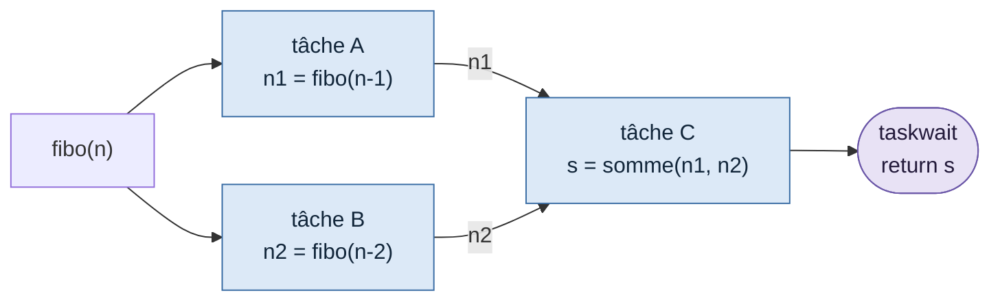

---
tags:
  - cours
  - parallelisme
  - ordonnancement
up: "[[APP — MOC]]"
date: 2026-09-25
updated: 2026-10-16
---

# Ordonnancement et théorème de Graham

> [!abstract] En une phrase
> Paralléliser, c'est **décrire du travail** ; c'est l'*ordonnanceur* (le runtime OpenMP, l'OS) qui décide *qui* exécute *quoi* et *quand*. Le programmeur ne contrôle que la **forme du travail** qu'il propose.

## Le programme vu comme un graphe de tâches

Un programme parallèle se modélise par un **DAG** (graphe orienté sans cycle) : un nœud = une tâche, une arête = une dépendance « doit finir avant ».



A et B sont **indépendantes** : deux cœurs peuvent les prendre en même temps. C est **bloquée** tant que les deux ne sont pas finies.

Deux grandeurs suffisent à borner tout ce qui suit :

| Grandeur | Nom | Lecture |
| --- | --- | --- |
| $T_1$ | **travail** (*work*) | somme des durées de toutes les tâches = temps sur 1 cœur |
| $T_\infty$ | **profondeur** (*span*, chemin critique) | plus long chemin du DAG = temps avec une infinité de cœurs |

> [!note] Deux bornes inférieures incontournables
> $$T_m \ge \frac{T_1}{m} \qquad\text{et}\qquad T_m \ge T_\infty$$
> La première dit qu'on ne peut pas exécuter plus de $m$ tâches à la fois, la seconde que le chemin critique est incompressible.
> Le **parallélisme disponible** vaut $T_1 / T_\infty$ : au-delà de ce nombre de cœurs, en ajouter ne sert plus à rien.

## Ordonnancement glouton

> [!info] Hypothèse
> On suppose un **ordonnancement glouton** : dès qu'un processeur est libre et qu'une tâche est prête, on la lui donne (jamais de processeur oisif s'il reste du travail disponible).

C'est exactement ce que fait le runtime OpenMP : chaque thread pioche dans la réserve de tâches prêtes, et **vole** du travail à ses voisins quand la sienne est vide.

## Théorème de Graham

Pour tout ordonnancement glouton sur $m$ processeurs, le makespan $T_{glouton}$ vérifie :

$$T_{glouton} \le \frac{T_1}{m} + T_\infty \qquad\Longrightarrow\qquad T_{glouton} \le \left(2 - \frac{1}{m}\right) \cdot T_{opt}$$

où $T_{opt}$ est le makespan optimal. Autrement dit, un ordonnancement glouton ne fait **jamais plus de $2 - 1/m$ fois** le temps optimal : même la stratégie la plus naïve reste à moins d'un facteur 2 de l'optimal.

> [!tip] Ce que dit vraiment la première forme
> $T_1/m$ = le travail parfaitement réparti, $T_\infty$ = le prix du chemin critique. Un glouton ne paie **que** la somme des deux : il est bon dès que le DAG est large et peu profond ($T_\infty \ll T_1/m$).

### La preuve tient dans une figure

```text
          0        2        4        6        8       10    temps
     P1 │██ J1 ████████│██████ B1 ███│  ·  │██ J2 ██│
     P2 │██ A2 ██│██ B2 ██│    ·      ·    │          │
     P3 │██ A3 ██│██ B3 ██│    ·      ·    │          │
     P4 │██ A4 ██│██ B4 ██│    ·      ·    │          │
        └──────────────────────────────────────────────┘ T_m
     ██ aire remplie = W        ·  instants oisifs
```

Notations du CM2 : $W$ = travail ($= T_1$), $CP$ = chemin critique ($= T_\infty$). Aire totale du rectangle : $m\,T_m$. Aire remplie : $W$. Donc l'aire **oisive** vaut $m\,T_m - W$.

Or, avec un ordonnancement glouton, un processeur n'est oisif que si **aucune tâche n'est prête** : à cet instant, une tâche du chemin critique est forcément en cours d'exécution. La durée totale des instants où **au moins un** processeur est oisif est donc $\le CP$, et à chacun de ces instants **au plus $m-1$** processeurs sont oisifs :

$$m\,T_m - W \le (m-1)\,CP \qquad\Longrightarrow\qquad T_m \le \frac{W}{m} + \left(1 - \frac{1}{m}\right) CP$$

Combiné avec les deux bornes inférieures : $\max\left(CP, \frac{W}{m}\right) \le T_{opt} \le T_{glouton} \le \frac{W}{m} + \left(1-\frac{1}{m}\right) CP$. Les deux extrémités diffèrent d'un facteur 2 au plus : **tout ordonnancement glouton est à un facteur 2 de l'optimal, sans rien calculer.** Pour un problème NP-difficile, c'est remarquable — et c'est ce qui justifie les heuristiques gloutonnes en pratique.

> [!warning] Réserve : les communications sont gratuites dans ce modèle
> Si on compte les communications dans $CP$ (ce qu'on fait en pratique), la garantie en $2 - 1/m$ ne tient plus. Le **vol de travail** (*work stealing*, CM du 13/11) atteint $O(W/m + CP)$ de façon **distribuée**, sans liste centrale : voir [[Vol de travail et schémas adaptatifs]].

> [!note] Pas de modèle universel
> En séquentiel, le modèle RAM (von Neumann) vaut pour toutes les machines. En parallèle, il n'y en a pas : d'un côté les extensions du modèle RAM (PRAM, Graham…) qui ne comptent que les calculs, de l'autre les modèles qui comptent finement les **messages** (voir le coût $\alpha + n/\beta$ de [[Mémoire partagée vs mémoire distribuée#Le coût d'un message|MPI]]). On ne passe pas de l'un à l'autre.

### La borne est atteinte

Trois tâches indépendantes A (1), B (1), C (2) sur $m = 2$ processeurs :

```text
   glouton (ordre A, B, C)              optimal
P1 │  A  │     C     │             P1 │     C     │
P2 │  B  │                         P2 │  A  │  B  │
   └─────┴─────┴─────┘                └─────┴─────┘
   0     1     2     3                0     1     2

   T_glouton = 3                       T_opt = 2
```

$3/2 = 2 - 1/2$ : la borne de Graham est **serrée**, on ne peut pas faire mieux comme garantie générale.

> [!abstract] La leçon
> Graham garantit que l'**ordonnanceur** ne vous fera pas perdre plus d'un facteur 2. Tout le reste de la performance vient de la **granularité** que vous lui donnez — voir [[Tâches OpenMP — exemple Fibonacci]].

## Voir aussi

- [[Tâches OpenMP — exemple Fibonacci]] — le DAG mis en pratique, et le piège du grain trop fin
- [[Vol de travail et schémas adaptatifs]] — la même borne sans liste centrale, et la preuve par jetons
- [[Accélération et efficacité]] — ce que l'ordonnancement coûte sur le speedup réel
- [[OPENMP]] — les directives côté langage
