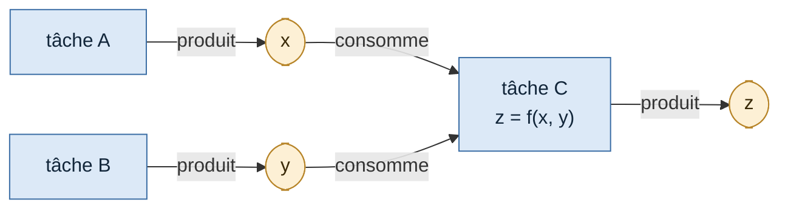
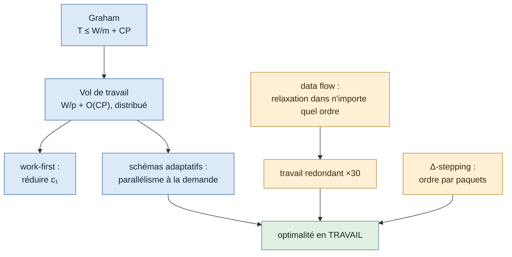

---
tags:
  - cours
  - parallelisme
  - dataflow
  - graphes
up: "[[APP — MOC]]"
date: 2026-11-13
status: à-réviser
---

# Parallélisme *data flow* — plus courts chemins

> [!abstract] En une phrase
> En *data flow*, une tâche ne s'exécute pas parce qu'on l'a appelée, mais **parce que ses données d'entrée sont prêtes**. Pour les plus courts chemins, chaque baisse d'une distance « allume » les voisins. C'est très parallèle, mais **on paie en travail redondant** : tout l'art est de doser l'ordre (Δ-stepping).

Seconde moitié du CM du 13/11. La première moitié, sur le vol de travail, est dans [[Vol de travail et schémas adaptatifs]].

---

## 1. Le modèle *data flow*

Le CM4 l'a posé : dans la version *dataflow* du graphe de tâches, **les données sont aussi des nœuds**, et les arcs disent **qui les produit** et **qui les consomme**.



**Règle de tir** : C s'exécute dès que `x` **et** `y` existent, quel que soit l'ordre dans lequel A et B ont fini. Personne n'écrit de `taskwait` : la synchronisation est portée par les données.

| | Flot de contrôle (*fork/join*) | Flot de données (*data flow*) |
| --- | --- | --- |
| Ce qui déclenche une tâche | un appel, un `spawn` | l'arrivée de ses entrées |
| Synchronisation | explicite : `taskwait`, `sync`, barrière | implicite : attendre une donnée |
| En OpenMP | `task` + `taskwait` | `task depend(in: …) depend(out: …)` |
| En Go | `sync.WaitGroup` | goroutines reliées par des **channels** |
| En MPI | — | `MPI_Recv` : on attend la donnée du voisin |

Voir [[Tâches OpenMP — dépendances et taskloop#`depend` : l'ordre entre tâches sœurs|`depend` en OpenMP]] et [[Go — goroutines et channels#Channels|les channels en Go]] : ce sont deux écritures du même modèle.

---

## 2. Plus courts chemins : deux algorithmes, deux philosophies

Problème : graphe orienté, poids $w \ge 0$, source $s$. Calculer $d(v)$, la distance de $s$ à tout sommet $v$.

Les deux algorithmes classiques reposent sur la même opération, la **relaxation** d'un arc $(u, v)$ :

$$d(v) \;\leftarrow\; \min\big(d(v),\; d(u) + w(u, v)\big)$$

### Dijkstra : optimal, mais séquentiel

On traite les sommets **dans l'ordre croissant** de distance (file de priorité). Chaque arc est relâché **exactement une fois** : travail $O(m + n \log n)$, optimal.

Mais l'ordre est **total** : on ne peut traiter le sommet suivant qu'après avoir fini le précédent. Le chemin critique fait $n$ étapes, donc **aucun parallélisme**.

### Bellman–Ford / relaxation : parallèle, mais redondant

On relâche les arcs **dans n'importe quel ordre**, jusqu'à ce que plus rien ne bouge. Ça converge toujours vers la bonne réponse :

> [!important] Pourquoi l'ordre n'a pas d'importance
> Le `min` est **monotone** : une distance ne fait que **baisser**, et ne descend jamais sous la vraie distance. Toute suite de relaxations finit donc au même **point fixe**. Aucun verrou n'est nécessaire, un **`min` atomique** (`compare-and-swap` en boucle) suffit. C'est exactement ce qu'il faut au *data flow* : les tâches peuvent se déclencher dans n'importe quel ordre sans changer le résultat.

Le prix à payer : un sommet relâché **trop tôt**, avec une distance encore provisoire, devra être **relâché à nouveau** quand sa distance baissera. C'est du **travail redondant**.

```text
   Dijkstra : chaque sommet traité UNE fois, dans l'ordre        data flow : un sommet peut « s'allumer » plusieurs fois

   s ──1──▶ a ──1──▶ b                                            s ──1──▶ a ──1──▶ b
   │                 ▲                                            │                 ▲
   └───────10────────┘                                            └───────10────────┘
   ordre : s(0), a(1), b(2)                                       s allume a et b en parallèle :
   → b relâché une fois, avec 2                                   b(10) part trop tôt, relâche ses arcs pour rien,
                                                                  puis a(1) → b(2) le rallume
```

---

## 3. Mesuré : *data flow* naïf en Go

Chaque amélioration d'une distance **déclenche une goroutine** qui relâche les arcs du sommet. C'est le runtime Go, avec son [[Vol de travail et schémas adaptatifs#Qui utilise le vol de travail|vol de travail]], qui répartit les goroutines sur les cœurs.

```go
// d[v] = min(d[v], x) sans verrou ; vrai si on a amélioré
func minAtomique(p *int64, x int64) bool {
    for {
        old := atomic.LoadInt64(p)
        if x >= old { return false }
        if atomic.CompareAndSwapInt64(p, old, x) { return true }
    }
}

var allume func(v int32)
allume = func(v int32) {               // un sommet « s'allume » : sa distance vient de baisser
    defer wg.Done()
    dv := atomic.LoadInt64(&d[v])
    for _, a := range g[v] {
        if minAtomique(&d[a.to], dv+int64(a.w)) {
            wg.Add(1)
            go allume(a.to)            // la donnée produite déclenche son consommateur
        }
    }
}
wg.Add(1); go allume(s); wg.Wait()     // fin = plus aucune donnée en circulation
```

Graphes en grille avec 10 % de raccourcis aléatoires, poids entiers dans $[1, 100]$. Portable 4 cœurs / 8 threads. Résultat **correct** à chaque fois (comparé à Dijkstra).

| Graphe | Dijkstra | *data flow*, 1 cœur | *data flow*, 8 threads | relaxations / Dijkstra |
| --- | ---: | ---: | ---: | ---: |
| 2 500 sommets | 2,0 ms | 41 ms | 11 ms | ×12 à ×17 |
| 10 000 sommets | 8,0 ms | 343 ms | 86 ms | ×33 à ×39 |
| 40 000 sommets | 31 ms | 1 120 ms | 377 ms | ×31 à ×44 |
| 490 000 sommets | 662 ms | **tué : mémoire épuisée** | | |

> [!danger] Accélération ×3… et 12 fois plus lent que le séquentiel
> D'un cœur à 8 threads, la version *data flow* va 3 à 4 fois plus vite : elle « passe à l'échelle ». Mais elle fait **30 à 40 fois trop de relaxations**, et finit **10 à 35 fois plus lente que Dijkstra**. Sur le gros graphe, les millions de goroutines en attente saturent la mémoire.
> D'où la définition du cours : l'**accélération se mesure contre le meilleur algorithme séquentiel**, pas contre soi-même sur un cœur. Voir [[Accélération et efficacité]].

C'est le même problème que le [[Vol de travail et schémas adaptatifs#4. Repliement (*folding*) et schémas adaptatifs|surcoût du préfixe parallèle]] : un algorithme parallèle à grain fin qui n'est **pas optimal en travail**. Et le même que le [[Tâches OpenMP — exemple Fibonacci#2. Le problème : trop de tâches|fibo sans seuil]] : une tâche par relaxation est un grain beaucoup trop fin.

---

## 4. Le compromis : Δ-stepping

Meyer & Sanders (2003) placent un curseur entre les deux extrêmes. On range les sommets dans des **paquets de largeur Δ** selon leur distance provisoire :

```text
   paquet 0          paquet 1           paquet 2           paquet 3
 [0, Δ[            [Δ, 2Δ[            [2Δ, 3Δ[            [3Δ, 4Δ[        …
 ┌─────────┐       ┌─────────┐        ┌─────────┐        ┌─────────┐
 │ s       │  ──▶  │ a  c  f │  ──▶   │ b  e    │  ──▶   │ d  g  h │
 └─────────┘       └─────────┘        └─────────┘        └─────────┘
   traité en         tous ses sommets
   premier           EN PARALLÈLE        → dans l'ordre entre paquets (comme Dijkstra)
                                         → en désordre dans un paquet (comme Bellman–Ford)
```

- **Entre les paquets**, ordre strict, comme Dijkstra : on ne relâche jamais un sommet beaucoup trop tôt.
- **Dans un paquet**, tous les sommets sont relâchés **en parallèle**. Un sommet amélioré qui retombe dans le paquet courant est retraité à la vague suivante.

Δ règle le compromis :

| Δ | Ressemble à | Parallélisme par vague | Travail redondant |
| --- | --- | --- | --- |
| petit (Δ ≤ plus petit poids) | Dijkstra | faible | nul |
| moyen | — | bon | faible |
| $\infty$ (un seul paquet) | Bellman–Ford synchrone | maximal | fort |

### Mesuré : Δ-stepping en Go

Même grille, **490 000 sommets, 2 millions d'arcs** — celle qui faisait exploser la version naïve. Pas une goroutine par sommet : **$p$ travailleurs** se partagent chaque vague en **blocs contigus** (gros grain).

| Δ | relaxations / optimal                                   vagues = synchronisations (échelle log)
  ×2,8 ┤                                    ●2,79          800 ┤ ○764
  ×2,4 ┤                                                   400 ┤
  ×2,0 ┤                             ●1,86                 200 ┤        ○238
  ×1,6 ┤                                                   100 ┤               ○106   ○80
  ×1,2 ┤ ●1,33  ●1,25  ●1,17  ●1,22                         50 ┤                             ○50    ○43
       └┬──────┬──────┬──────┬──────┬──────┬──────→ Δ          └┬──────┬──────┬──────┬──────┬──────┬──────→ Δ
        1      10     50     100    400    ∞                    1      10     50     100    400    ∞

  Δ petit : peu de travail en trop, beaucoup de vagues   ◀──▶   Δ grand : peu de vagues, beaucoup de travail
```text
relaxations / optimal                                    nombre de vagues (synchronisations)
  ×2,8 ┤                                    ●            
  ×2,6 ┤                                                 
  ×2,4 ┤                                                 
  ×2,2 ┤                                                    750 ┤ ○
  ×2,0 ┤                                                    600 ┤
  ×1,8 ┤                             ●                      450 ┤
  ×1,6 ┤                                                    300 ┤        ○
  ×1,4 ┤ ●                                                  150 ┤               ○      ○
  ×1,2 ┤        ●      ●      ●                               0 ┤                             ○      ○
       └┬──────┬──────┬──────┬──────┬──────┬──────→ Δ           └┬──────┬──────┬──────┬──────┬──────┬──────→ Δ
        1      10     50     100    400    ∞                     1      10     50     100    400    ∞
        ◀── peu de travail en trop          beaucoup de travail en trop ──▶
                                                                 764   238   106    80    50    43
```

- **Δ trop petit** : très peu de travail redondant, mais 764 vagues, chacune avec trop peu de sommets pour occuper 8 threads.
- **Δ trop grand** : 43 vagues seulement, mais presque 3 fois trop de relaxations.
- **Le meilleur réglage est au milieu** (Δ ≈ 50 à 100, de l'ordre du poids moyen) : 1,2 fois le travail optimal, et le temps le plus court.

> [!warning] Lire honnêtement ces chiffres
> - Le Dijkstra de référence (`container/heap` de Go, 662 à 782 ms) est **lent** : le tas générique passe par des interfaces. Avec des poids entiers, Δ = 1 sur un cœur revient à une **file à paquets** (algorithme de Dial) : **c'est lui le meilleur séquentiel ici** (~250–290 ms).
> - Contre cette référence, le gain parallèle réel est d'environ **×1,8 sur 8 threads**. Le parcours de graphe est limité par la **mémoire** (accès aléatoires), pas par le calcul : voir [[Latence et débit — de l'horloge au réseau#Débit mémoire et calcul|débit mémoire]]. Et le portable n'a que 4 cœurs physiques.

---

## 5. Ce que relie ce CM



> [!abstract] La leçon commune
> Le vol de travail garantit qu'on exploite bien les cœurs, mais il ne compte que le travail **qu'on lui donne**. Un algorithme parallèle qui fait 30 fois plus d'opérations qu'il ne faut sera « bien parallélisé »… et lent. Les deux moitiés du CM disent la même chose : **rester proche du travail séquentiel optimal**, et n'ajouter du parallélisme que là où il paie.

## Voir aussi

- [[Vol de travail et schémas adaptatifs]] — l'ordonnanceur qui exécute ces tâches
- [[Tâches OpenMP — dépendances et taskloop]] — le *data flow* écrit avec `depend`
- [[Go — goroutines et channels]] — le langage des expériences, et du TP du 20/11
- [[Accélération et efficacité]] — accélération par rapport au meilleur séquentiel

## Sources

- U. Meyer, P. Sanders, *[Δ-stepping: a parallelizable shortest path algorithm](https://www.cs.utexas.edu/~pingali/CS395T/2013fa/papers/delta-stepping.pdf)*, Journal of Algorithms 49(1), 2003
- J. Shun, *[Parallel shortest paths — cours MIT 6.886](https://jshun.csail.mit.edu/6886-s19/lectures/lecture23-1.pdf)* — arcs légers et lourds
- Mesures : `APP/demos/sssp/` (Go 1.22 : `go build -buildvcs=false -o /tmp/sssp . && /tmp/sssp 700 delta`, et `/tmp/sssp 200 dataflow` pour la version naïve — à 700 elle épuise la mémoire), 13/11/2026
