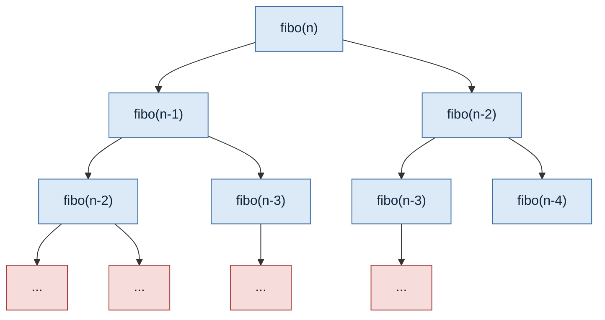

---
tags:
  - cours
  - parallelisme
  - openmp
  - ordonnancement
up: "[[APP — MOC]]"
date: 2026-09-25
updated: 2026-10-16
---

# Tâches OpenMP — exemple Fibonacci

Exemple du tableau : en quatre versions, il montre comment un DAG **correct** peut rester **catastrophiquement lent**. Le modèle théorique est dans [[Ordonnancement et théorème de Graham]], les directives dans [[OPENMP]].

> [!warning] Le squelette obligatoire
> Les tâches n'existent que dans une région parallèle, et un **seul** thread doit amorcer la récursion — sinon chaque thread construit l'arbre entier.
> ```c
> #pragma omp parallel
> #pragma omp single
>     printf("%d\n", fibo(45));
> ```

## 1. Dépendances explicites — `depend`

```c
int somme(int a, int b) { return a + b; }

int fibo(int n) {
    int n1, n2, s;
    if (n < 2) return n;

    #pragma omp task shared(n1) depend(out: n1)
    n1 = fibo(n - 1);

    #pragma omp task shared(n2) depend(out: n2)
    n2 = fibo(n - 2);

    #pragma omp task shared(s, n1, n2) depend(in: n1, n2) depend(out: s)
    s = somme(n1, n2);

    #pragma omp taskwait
    return s;
}
```

Ici on **écrit le DAG à la main** :

- `shared(...)` : la variable est bien celle de l'appelant, sinon la tâche écrirait dans une copie privée et le résultat serait perdu (voir [[Parallélisme C++#Data race|données partagées]]).
- `depend(out: n1)` : la tâche *produit* `n1`.
- `depend(in: n1, n2)` : la tâche *consomme* `n1` et `n2`, donc le runtime ne la rendra prête qu'après les deux productrices.
- `taskwait` : on attend les tâches filles avant de lire `s`.

> [!warning] `depend` ne remplace pas `taskwait`
> `depend` ordonne les tâches **entre elles**. Sans `taskwait`, l'appelant retournerait `s` avant que la tâche C ne l'ait écrit.

## 2. Le problème : trop de tâches

Le DAG d'appels de `fibo` est un arbre binaire déséquilibré :



Le nombre de nœuds vaut $\approx 2 F(n)$, soit une croissance en $\varphi^{\,n}$ ($\varphi \approx 1{,}618$). Pour $n = 45$ : **quelques milliards de tâches**, alors que chaque feuille ne fait qu'une addition.

> [!danger] Le coût de création d'une tâche est fixe
> Créer une tâche coûte un temps **constant** (allocation, mise en file, réveil d'un thread). Si le travail de la tâche est plus petit que ce coût, on passe tout son temps à ordonnancer au lieu de calculer : le programme parallèle devient **plus lent** que le séquentiel.
> C'est le problème de **granularité** : une tâche doit représenter beaucoup plus de travail que sa propre création.

## 3. Seuil de récursion (*cutoff*)

On arrête de créer des tâches en dessous d'une taille de problème, et on bascule sur la version séquentielle :

```c
int fibo_seq(int n);   // version séquentielle classique, sans aucun pragma

int fibo(int n) {
    if (n < 2)  return n;
    if (n < 30) return fibo_seq(n);   // ← seuil : plus une seule tâche en dessous

    int n1, n2;

    #pragma omp task shared(n2)
    n2 = fibo(n - 2);

    n1 = fibo(n - 1);      // exécuté directement par la tâche courante

    #pragma omp taskwait
    return n1 + n2;
}
```

Deux optimisations cumulées :

1. **Le seuil** : seuls les nœuds avec $n \ge 30$ créent des tâches → on retombe de $\sim 10^9$ à $\sim 10^3$ tâches, chacune portant un vrai paquet de calcul.
2. **Une tâche au lieu de deux** : la branche `n-1` est exécutée par la tâche courante, qui de toute façon devrait attendre. On divise par deux le nombre de créations, et on garde la [[Localité et caches|localité]].

```text
         n = 45    ┐
         n = 44    │  zone « tâches » — gros grain, on parallélise
         ...       │
         n = 30    ┘
    ──────────────── seuil
         n = 29    ┐
         ...       │  zone « séquentielle » — grain trop fin, fibo_seq
         n = 0     ┘
```

## 4. Variante : le seuil dans le pragma

Plutôt qu'un `if` en C, on peut laisser la directive décider :

```c
#pragma omp task shared(n2) if (n > 30)      // tâche créée seulement si n > 30
n2 = fibo(n - 2);
```

```c
#pragma omp task shared(n2) final(n < 30)    // à partir de n < 30, plus aucune tâche fille
n2 = fibo(n - 2);
```

> [!note] `if` et `final` ne font pas la même chose
> - `if(cond)` **fausse** : la tâche est exécutée *immédiatement* par le thread rencontrant la directive. Décision prise **à chaque** directive.
> - `final(cond)` **vraie** : la tâche est créée, mais toute sa descendance sera exécutée en ligne. Une seule décision coupe **tout le sous-arbre** — c'est le vrai « on arrête de créer des tâches ».

## Récapitulatif

| Version | Tâches créées pour $n=45$ | Surcoût d'ordonnancement | Quand l'utiliser |
| --- | --- | --- | --- |
| `depend` explicite | $\sim 3 \times 10^9$ | catastrophique | pédagogique, ou DAG irrégulier peu profond |
| 1 tâche + `taskwait` | $\sim 2 \times 10^9$ | encore trop élevé | jamais seul, à combiner avec un seuil |
| **Seuil `if (n < 30)`** | $\sim 10^3$ | négligeable | **le bon réflexe** pour une récursion |
| `final(n < 30)` | $\sim 10^3$ | négligeable | coupe tout le sous-arbre d'un coup |

> [!tip] Pourquoi `shared(n2)` est indispensable
> Dans une tâche, une variable locale de la fonction est **`firstprivate` par défaut** : sans `shared(n2)`, la tâche écrirait dans sa propre copie et l'appelant lirait un `n2` jamais affecté. Voir [[Tâches OpenMP — dépendances et taskloop#Rappels|les attributs par défaut]].

## Voir aussi

- [[Tâches OpenMP — dépendances et taskloop]] — la suite : types de `depend`, `taskgroup`, `taskloop`, le tri fusion et Cholesky des TP
- [[Ordonnancement et théorème de Graham]] — la théorie derrière ce DAG
- [[OPENMP]] — les autres catégories de directives
