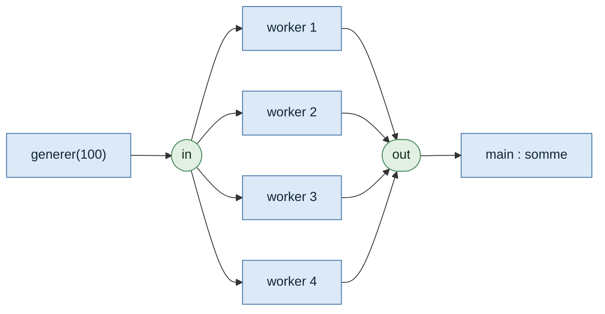

---
tags:
  - cours
  - parallelisme
  - go
  - concurrence
up: "[[APP — MOC]]"
date: 2026-10-16
updated: 2026-11-09
status: à-compléter
source: "TP7 — tp7-go.pdf (N. du Pasquier)"
---

# Go — goroutines et channels

> [!abstract] En une phrase
> En Go, on lance un calcul concurrent en écrivant `go` devant un appel de fonction, et on fait communiquer (et se synchroniser) les goroutines par des **channels** plutôt que par de la mémoire partagée.

> [!todo] À compléter avec le cours
> Les CM Go du 03/11 et du 17/11 n'ont pas de support en ligne : cette note repose sur l'énoncé du TP7 (`TP/tp7-go.pdf`, PDF du 15/10), et ce qui le dépasse est signalé. Dans cette version, les sections 4 (`for`–`select`) et 5 (« Un premier programme ») sont **vides**, et le PDF n'est plus lié sur le site : l'énoncé du TP du 10/11 peut être différent. Les fichiers `hello_go.go` et `channels.go` qu'il mentionne ne sont pas en ligne.

## Compiler et lancer

*Hors énoncé.*

```bash
go run hello_go.go          # compile et exécute
go run -race channels.go    # avec le détecteur de data races
go vet channels.go          # analyse statique
```

- Une variable locale ou un import inutilisés sont des **erreurs de compilation** : `x declared and not used`, `"os" imported and not used`. Commenter le seul `fmt.Println` d'un fichier suffit à casser le build.
- `-race` repose sur ThreadSanitizer, comme en C/C++ (voir [[Compiler, déboguer, mesurer]]).
- `GOMAXPROCS` borne le nombre de threads qui exécutent du Go en même temps ; par défaut, c'est le nombre de cœurs logiques. `GOMAXPROCS=1 go run …` donne de la concurrence sans parallélisme.

## Goroutines

```go
go f(x)        // crée une goroutine qui exécute f(x) ; l'appelant continue tout de suite
```

- Les goroutines s'exécutent **en concurrence**, et **en parallèle** si la machine le permet (voir [[Parallélisme, asynchronisme, concurrence]]).
- Le programme principal **n'attend pas** la fin des goroutines : quand `main` retourne, tout s'arrête. D'où le `time.Sleep` dans la fonction `repeat` du TP.

> [!danger] Synchroniser avec `time.Sleep` : jamais
> Comme dans tous les langages, attendre « assez longtemps » n'est pas une synchronisation : ça marche par hasard, et ça casse dès que la machine est chargée. Il faut un channel (ou `sync.WaitGroup`).

Le paquet `sync` (`Mutex`, `WaitGroup`…) existe et ressemble à ce qu'on a vu en [[Parallélisme C++]], mais le TP se concentre sur les channels.

**Exercice 1 du TP** : lancer un seul appel à `repeat`, puis les deux, dans des goroutines. `hello_go.go` n'étant pas en ligne, cette version de `repeat` est reconstruite d'après l'énoncé :

```go
func repeat(s string) {
    for i := 0; i < 3; i++ {
        time.Sleep(100 * time.Millisecond)
        fmt.Println(s)
    }
}
```

| Corps de `main` | Sortie observée | Durée | Ce qui se passe |
| --- | --- | --- | --- |
| `repeat("a")` ; `repeat("b")` | `a a a b b b` | 600 ms | Séquentiel |
| `go repeat("a")` ; `repeat("b")` | `a` et `b` entremêlés, 2 ou 3 `a` selon l'exécution | 300 ms | `main` finit avec `repeat("b")` : le dernier `a` fait la course avec la fin du programme |
| `repeat("a")` ; `go repeat("b")` | `a a a` | 300 ms | La goroutine `b` vient de naître quand `main` retourne |
| `go repeat("a")` ; `go repeat("b")` | rien | 0 s | `main` retourne aussitôt |

Réponse à la question de l'énoncé : seuls les appels **sans** `go` retiennent `main`, et la fin de `main` termine le programme, quelles que soient les goroutines encore en cours.

Pour que `main` attende vraiment, on utilise un channel :

```go
done := make(chan struct{})
go func() {
    repeat("a")
    close(done)         // réveille tous ceux qui attendent sur done
}()
repeat("b")
<-done                  // 3 a et 3 b à chaque exécution, en 300 ms
```

## Channels

```go
ch := make(chan string)   // channel non tamponné
go send(ch)               // goroutine qui écrit sur ch
fmt.Println(<-ch)         // lecture : bloque jusqu'à ce qu'une valeur arrive
```

- `ch <- v` envoie, `v := <-ch` reçoit.
- Sur un channel **non tamponné**, l'envoi et la réception se donnent rendez-vous : chacun bloque jusqu'à ce que l'autre soit là. La communication **est** la synchronisation.
- On peut restreindre la direction dans une signature : `chan<- int` (écriture seule), `<-chan int` (lecture seule).

Un channel peut aussi être **tamponné** (hors énoncé) : l'envoi ne bloque que si le tampon est plein, la réception que s'il est vide.

```go
ch := make(chan int, 2)
ch <- 1
ch <- 2                         // ne bloque pas : il reste de la place
fmt.Println(len(ch), cap(ch))   // 2 2
```

C'est la même différence qu'entre les protocoles *rendez-vous* et *eager* de [[MPI#Ce que « bloquant » veut dire|MPI]] : un tampon cache les interblocages tant qu'il reste de la place.

**Exercice 2 du TP** : `power` envoie son résultat sur un channel au lieu de le retourner.

```go
func power(x int, ch chan<- int) { ch <- x * x }

ch := make(chan int)
go power(3, ch)
go power(4, ch)
a, b := <-ch, <-ch          // l'ordre d'arrivée n'est pas garanti ; la somme, si
fmt.Println("a+b =", a+b)   // a+b = 25
```

> [!warning] Autant de réceptions que d'envois
> Avec un seul `go power(3, ch)` et deux réceptions, le second `<-ch` n'a jamais de réponse : `fatal error: all goroutines are asleep - deadlock!`. Même erreur pour un `ch <- 1` dans `main` sans lecteur en face. Le runtime ne le détecte que si **toutes** les goroutines sont bloquées ; si une autre tourne encore, le programme reste figé sans message.

## Fermeture et parcours

Règles de fermeture :

1. ne **jamais** fermer un channel déjà fermé ;
2. ne **jamais** écrire sur un channel fermé ;
3. toujours fermer **côté écriture**.

Ces règles compliquent la fermeture quand **plusieurs** goroutines écrivent sur le même channel : aucune ne sait seule qu'elle est la dernière.

Ne pas fermer est possible, **mais** `for v := range ch` lit toutes les valeurs **jusqu'à la fermeture** — sans `close`, la boucle ne se termine jamais. Une fois le dernier écrivain parti, le programme meurt sur l'erreur de deadlock.

```go
func producteur(n int, ch chan<- int) {
    for i := 0; i < n; i++ {
        ch <- i
    }
    close(ch)                   // côté écriture, une seule fois
}

nums := make(chan int)
go producteur(5, nums)
for v := range nums {           // s'arrête à la fermeture
    fmt.Print(v, " ")           // 0 1 2 3 4
}
```

Après `close`, une réception ne bloque plus : elle rend ce qui reste dans le tampon, puis la valeur nulle du type. La forme à deux résultats distingue les deux cas :

```go
ch := make(chan int, 1)
ch <- 7
close(ch)
v, ok := <-ch
fmt.Println(v, ok)          // 7 true
v, ok = <-ch
fmt.Println(v, ok)          // 0 false
```

### Plusieurs écrivains

*Solution classique, hors énoncé.* On confie la fermeture à une goroutine de plus, qui attend la fin de tous les écrivains :

```go
ch := make(chan int)
var wg sync.WaitGroup
for i := 1; i <= 3; i++ {
    wg.Add(1)                   // avant le go, pas dedans
    go func(id int) {
        defer wg.Done()
        ch <- id * id
    }(i)
}
go func() {                     // seule responsable du close
    wg.Wait()
    close(ch)
}()
total := 0
for v := range ch {
    total += v
}
fmt.Println("total =", total)   // total = 14
```

Sans `sync` : chaque écrivain envoie aussi un jeton sur un channel `done`, et la goroutine de fermeture lit `n` jetons avant de faire `close(ch)`.

## `for`–`select`

`select` attend sur **plusieurs** channels à la fois et exécute la branche du premier prêt :

```go
tick := time.NewTicker(10 * time.Millisecond)
defer tick.Stop()
fin := time.After(35 * time.Millisecond)
for {
    select {
    case <-tick.C:
        fmt.Println("tick")
    case <-fin:
        fmt.Println("fin")
        return
    }
}
```

```text
tick
tick
tick
fin
```

La section de l'énoncé est vide ; les règles suivantes viennent de la spécification du langage.

- Si plusieurs branches sont prêtes, `select` en choisit une **au hasard** (mesuré sur 10 000 tirages avec deux channels prêts : 4 992 et 5 008).
- Avec une branche `default`, `select` ne bloque plus.
- Un channel **fermé** est toujours prêt : sa branche se déclenche sans arrêt, en lisant des zéros.
- Un channel `nil` n'est jamais prêt : passer la variable à `nil` désactive sa branche.

Les deux derniers points donnent la fusion de deux flux, jusqu'à la fermeture des deux :

```go
func fusion(a, b <-chan int) []int {
    var res []int
    for a != nil || b != nil {
        select {
        case v, ok := <-a:
            if !ok {
                a = nil         // a est fini : on désactive sa branche
                continue
            }
            res = append(res, v)
        case v, ok := <-b:
            if !ok {
                b = nil
                continue
            }
            res = append(res, v)
        }
    }
    return res
}
```

Pour arrêter une goroutine depuis l'extérieur, on ferme un channel dédié, ce qui prévient tous ses lecteurs d'un coup :

```go
stop := make(chan struct{})
go func() {
    for {
        select {
        case <-stop:
            return
        default:
            // une tranche de travail
        }
    }
}()
time.Sleep(10 * time.Millisecond)
close(stop)
```

## S'entraîner : un pipeline complet

La section 5 de l'énoncé (« Un premier programme ») est vide. Cet exercice n'en vient donc pas : il réunit ce qui précède, avec les motifs *fan-out* (plusieurs workers lisent le même channel) et *fan-in* (ils écrivent tous dans le même).



```go
func generer(n int) <-chan int {
    out := make(chan int)
    go func() {
        defer close(out)
        for i := 1; i <= n; i++ {
            out <- i
        }
    }()
    return out
}

func carres(in <-chan int, nbWorkers int) <-chan int {
    out := make(chan int)
    var wg sync.WaitGroup
    wg.Add(nbWorkers)
    for w := 0; w < nbWorkers; w++ {
        go func() {
            defer wg.Done()
            for v := range in {
                out <- v * v
            }
        }()
    }
    go func() {
        wg.Wait()
        close(out)
    }()
    return out
}

func main() {
    somme := 0
    for v := range carres(generer(100), 4) {
        somme += v
    }
    fmt.Println("somme =", somme)   // somme = 338350
}
```

Chaque étape crée son channel de sortie, le renvoie en lecture seule et se charge de le fermer : `generer` directement, car elle est seule à écrire, et `carres` via le `WaitGroup`, car elle a quatre écrivains. La fin se propage de gauche à droite, et `main` n'a rien à compter.

## Pièges fréquents

| Symptôme | Cause | Correction |
| --- | --- | --- |
| Rien ne s'affiche, ou seulement une partie | `main` retourne avant ses goroutines | Attendre sur un channel ou un `WaitGroup` |
| `fatal error: all goroutines are asleep - deadlock!` | Réception sans envoi à venir, envoi sans lecteur, ou `for range` sur un channel jamais fermé | Compter envois et réceptions, fermer côté écriture |
| `panic: send on closed channel` | Un écrivain tourne encore au moment du `close` | Fermer après la fin de tous les écrivains |
| `panic: close of closed channel` | Deux `close` sur le même channel | Une seule goroutine responsable de la fermeture |
| `select` qui tourne à vide | Un channel fermé est toujours prêt | `v, ok := <-ch`, puis `ch = nil` |
| Toutes les goroutines d'une boucle voient le même `i` | Variable de boucle partagée si le `go.mod` indique une version < 1.22 (`[3 3 3]` au lieu de `[0 1 2]`) | Passer `i` en paramètre : `go func(id int) { … }(i)` |
| Résultat faux, non reproductible | Data race sur une variable partagée | `go run -race` |

*Exemples vérifiés avec go 1.22.2 (`go run`).*

## Voir aussi

- [[Parallélisme, asynchronisme, concurrence]] — concurrence ≠ parallélisme, en Go aussi
- [[Parallélisme C++]] — threads, `mutex`, `condition_variable` : le modèle « mémoire partagée » que Go déconseille
- [[MPI]] — l'autre modèle à échange de messages, entre processus
- [[Compiler, déboguer, mesurer]] — ThreadSanitizer, sur lequel repose `go run -race`
- [[Vol de travail et schémas adaptatifs#Qui utilise le vol de travail|Vol de travail]] — comment le runtime répartit les goroutines (TP du 20/11)
- [[Parallélisme data flow — plus courts chemins]] — plus courts chemins avec une goroutine par sommet allumé

## Sources

- TP7, *Goroutines et Channels* (`TP/tp7-go.pdf`)
- Hors énoncé : [spécification du langage Go](https://go.dev/ref/spec) et [notes de version de Go 1.22](https://go.dev/doc/go1.22) pour la variable de boucle
