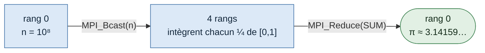

---
tags:
  - cours
  - parallelisme
  - mpi
  - hpc
up: "[[APP — MOC]]"
date: 2026-10-13
updated: 2026-11-09
status: à-réviser
source: "CM5 (13/10) ; CM6 — CM2-MPI-CommCollectives.pdf (16/10) ; TP MPI 1 et 2 (20 et 23/10)"
---

# MPI — Message Passing Interface

Le standard de la programmation en [[Mémoire partagée vs mémoire distribuée|mémoire distribuée]] : des processus sans mémoire commune, qui ne communiquent que par **messages**. Pendant de [[OPENMP]] (mémoire partagée).

> [!info] MPI est une norme, pas une bibliothèque
> Le **MPI Forum** publie une *spécification* (MPI-4.1 aujourd'hui). Ce sont des **implémentations** qui la réalisent : **Open MPI**, **MPICH**, Intel MPI… Un code conforme se recompile tel quel de l'une à l'autre.
> La norme définit plus de 430 routines, mais **une douzaine suffit** à la plupart des programmes.

---

## Squelette d'un programme

```c
#include <mpi.h>
#include <stdio.h>

int main(int argc, char **argv) {
    MPI_Init(&argc, &argv);

    int rank, size;
    MPI_Comm_rank(MPI_COMM_WORLD, &rank);   // qui suis-je ?
    MPI_Comm_size(MPI_COMM_WORLD, &size);   // combien sommes-nous ?

    printf("processus %d sur %d\n", rank, size);

    MPI_Finalize();
    return 0;
}
```

```bash
mpicc -O2 -o hello hello.c       # wrapper autour de gcc : ajoute -I et -lmpi
mpirun -np 4 ./hello              # lance 4 copies du MÊME programme (SPMD)
```

```text
processus 2 sur 4
processus 0 sur 4
processus 3 sur 4
processus 1 sur 4
```

> [!warning] L'ordre d'affichage n'est pas déterministe
> Les 4 processus tournent indépendamment. Sous Open MPI, ajouter `--oversubscribe` pour lancer plus de processus que de cœurs disponibles.

| Fonction | Rôle |
| --- | --- |
| `MPI_Init` / `MPI_Finalize` | début et fin de la zone MPI — rien d'MPI avant, rien après |
| `MPI_Comm_size` | nombre $p$ de processus dans le communicateur |
| `MPI_Comm_rank` | rang $r \in \{0,\dots,p-1\}$ du processus appelant |
| `MPI_COMM_WORLD` | **communicateur** contenant tous les processus lancés |
| `MPI_Wtime()` | horloge murale en secondes (voir [[Parallélisme C++#Mesurer le temps\|mesurer le temps]]) |

---

## Communication point à point

```c
int MPI_Send(const void *buf, int count, MPI_Datatype datatype,
             int dest,   int tag, MPI_Comm comm);

int MPI_Recv(void *buf,       int count, MPI_Datatype datatype,
             int source, int tag, MPI_Comm comm, MPI_Status *status);
```

Un message = des **données** (`buf`, `count`, `datatype`) + une **enveloppe** :

```text
   ┌───────────────────── enveloppe ──────────────────────┐
   │ source : 0   dest : 3   tag : 7   comm : WORLD       │
   ├──────────────────────────────────────────────────────┤
   │ données : count × datatype  (ex. 100 × MPI_DOUBLE)   │
   └──────────────────────────────────────────────────────┘
```

Un `MPI_Recv` n'accepte un message que si **source, tag et communicateur** correspondent.

- **`datatype`** : `MPI_INT`, `MPI_DOUBLE`, `MPI_CHAR`… — en éléments, **pas en octets**.
- **`count`** : `Send` envoie exactement `count` éléments, `Recv` en accepte **au plus** `count`.
- **Jokers** : `MPI_ANY_SOURCE`, `MPI_ANY_TAG` côté réception. On retrouve alors l'expéditeur dans `status.MPI_SOURCE`, le tag dans `status.MPI_TAG`, et la taille réelle avec `MPI_Get_count`.
- Si l'information ne sert pas : `MPI_STATUS_IGNORE`.

> [!info] Notation du cours pour le coût d'un message
> Le CM6 écrit le coût d'un message de $l$ octets $\beta + l\tau$ ($\beta$ : latence, $\tau$ : inverse du débit). C'est le même modèle que $\alpha + n/\beta$ de [[Mémoire partagée vs mémoire distribuée#Le coût d'un message|cette note]], avec d'autres lettres : attention, **$\beta$ n'a pas le même sens** dans les deux.

> [!note] Garanties de la norme
> - **Ordre** : deux messages d'un même expéditeur vers un même destinataire, appariables par la même réception, **ne se doublent pas**.
> - **Pas d'équité** : si plusieurs expéditeurs visent un même `Recv(MPI_ANY_SOURCE)`, rien ne garantit qu'ils seront servis à tour de rôle. Éviter la famine est à la charge du programmeur.

### Ce que « bloquant » veut dire

> [!danger] `MPI_Send` qui retourne ≠ message reçu
> `MPI_Send` (mode **standard**) retourne quand le buffer d'envoi est **réutilisable**. Les données peuvent être déjà chez le destinataire… ou simplement **copiées dans un tampon** de la bibliothèque.
> La norme **autorise** ce tampon sans **l'imposer** : c'est l'implémentation qui choisit, en général selon la taille du message.

En pratique, les implémentations utilisent deux protocoles :

```text
 PETIT message — protocole « eager »          GROS message — protocole « rendez-vous »
 P0                        P1                 P0                        P1
 Send ──── données ──────▶ [tampon]           Send ── « prêt ? » ─────▶
  │ retour immédiat                            │  ⏳ bloqué...
  ▼                         Recv ◀─ copie      │                        Recv
                                  │ ◀──── « vas-y » ────────┘
                                  │ ──── données ─────────▶
	                              ▼ retour
```

`MPI_Recv`, lui, ne retourne **que** quand les données sont arrivées dans `buf`.

---

## Le piège : l'interblocage

Échange symétrique entre deux processus (exemples de la norme MPI) :

| | Rang 0 | Rang 1 | Verdict |
| --- | --- | --- | --- |
| **Sûr** | `Send` puis `Recv` | `Recv` puis `Send` | ✅ termine toujours |
| **Bloqué** | `Recv` puis `Send` | `Recv` puis `Send` | ❌ **toujours** bloqué : chacun attend l'autre |
| **Non sûr** | `Send` puis `Recv` | `Send` puis `Recv` | ⚠️ termine **seulement si** la bibliothèque tamponne |

Le cas « non sûr » est le plus traître : il **marche en test et bloque en production** dès que les messages grossissent.

> [!example] Mesuré — Open MPI 4.1.6, 2 processus sur la même machine
> Échange « non sûr » de $n$ `double` :
>
> | $n$ | Taille | Résultat |
> | --- | --- | --- |
> | 100 | 800 o | ✅ termine |
> | 505 | 4 040 o | ✅ termine |
> | 506 | 4 048 o | ❌ **bloqué indéfiniment** |
> | 1 000 000 | 8 Mo | ❌ bloqué |
>
> Le seuil correspond à la limite *eager* de la mémoire partagée d'Open MPI (`btl_vader_eager_limit` = 4 096 octets, en-tête compris). Le même code avec `MPI_Sendrecv` termine pour toutes les tailles.

> [!tip] Règle de la norme
> *Un programme portable ne doit pas compter sur le tampon système.* Un programme « sûr » termine même si la bibliothèque ne tamponne rien.

**Trois solutions :**

1. **Casser la symétrie** : les rangs pairs envoient d'abord, les impairs reçoivent d'abord.
2. **`MPI_Sendrecv`** : la bibliothèque gère l'ordre elle-même.
   ```c
   MPI_Sendrecv(out, n, MPI_DOUBLE, autre, 0,     // ce que j'envoie
                in,  n, MPI_DOUBLE, autre, 0,     // ce que je reçois
                MPI_COMM_WORLD, MPI_STATUS_IGNORE);
   ```
3. **Communications non bloquantes** (section suivante).

---

## Communications non bloquantes

Les versions `I` (*immediate*) retournent **tout de suite** et rendent une `MPI_Request` ; on attend la fin plus tard.

```c
int MPI_Isend(const void *buf, int count, MPI_Datatype type, int dest,
              int tag, MPI_Comm comm, MPI_Request *request);
int MPI_Irecv(void *buf, int count, MPI_Datatype type, int source,
              int tag, MPI_Comm comm, MPI_Request *request);

int MPI_Wait   (MPI_Request *request, MPI_Status *status);       // bloque
int MPI_Waitall(int n, MPI_Request reqs[], MPI_Status stats[]);
int MPI_Test   (MPI_Request *request, int *flag, MPI_Status *status);  // ne bloque pas
```

**Exemple : échange avec les deux voisins sur un anneau.** Aucun ordre à choisir, aucun interblocage possible :

```c
int gauche = (rank - 1 + size) % size;
int droite = (rank + 1) % size;
int de_gauche, de_droite;
MPI_Request req[4];

// on poste tout, sans jamais bloquer...
MPI_Irecv(&de_gauche, 1, MPI_INT, gauche, 0, MPI_COMM_WORLD, &req[0]);
MPI_Irecv(&de_droite, 1, MPI_INT, droite, 0, MPI_COMM_WORLD, &req[1]);
MPI_Isend(&rank,      1, MPI_INT, gauche, 0, MPI_COMM_WORLD, &req[2]);
MPI_Isend(&rank,      1, MPI_INT, droite, 0, MPI_COMM_WORLD, &req[3]);

// ... ici on peut CALCULER pendant que les messages circulent ...

MPI_Waitall(4, req, MPI_STATUSES_IGNORE);   // avant de lire les buffers
```

```text
rang 0 : gauche = 3, droite = 1
rang 1 : gauche = 0, droite = 2
rang 2 : gauche = 1, droite = 3
rang 3 : gauche = 2, droite = 0
```

> [!danger] Ne pas toucher au buffer avant `Wait`
> Entre `Isend`/`Irecv` et le `Wait` correspondant, le buffer appartient à MPI : le modifier (envoi) ou le lire (réception) donne un résultat indéfini.

- Un `MPI_Irecv` peut recevoir un `MPI_Send` ordinaire, et réciproquement : seul le côté qui l'emploie est concerné.
- Les modes d'envoi existent aussi en non bloquant : `MPI_Issend` (synchrone), `MPI_Ibsend` (bufferisé), `MPI_Irsend` (*ready*).

### Attendre ou tester une ou plusieurs requêtes

| | une requête | toutes | l'une d'elles | celles qui ont fini |
| --- | --- | --- | --- | --- |
| **bloque** jusqu'à la fin | `MPI_Wait` | `MPI_Waitall` | `MPI_Waitany` (rend son indice) | `MPI_Waitsome` |
| **rend la main** tout de suite | `MPI_Test` | `MPI_Testall` | `MPI_Testany` | `MPI_Testsome` |

> [!warning] Toute requête doit être terminée
> Par l'une de ces fonctions, ou libérée par `MPI_Request_free`. Sinon les ressources de MPI s'accumulent, et le programme peut se terminer avant que le message soit parti. Une requête terminée vaut `MPI_REQUEST_NULL` : on peut la retester sans danger.

### Recouvrir les communications par le calcul

```text
P0  │ Irecv │████ calcul indépendant ████│ Wait │ calcul++ ...
                    ╲  message : β + lτ  ╲
P1  │ Isend │████ calcul ███████████████████████...
```

Si le calcul indépendant dure plus que $\beta + l\tau$, le `MPI_Wait` ne coûte presque rien : la communication est **recouverte**. Il faut donc du travail qui ne dépend pas du message — l'analogue des tâches prêtes du [[Ordonnancement et théorème de Graham|graphe de tâches]].

> [!warning] Non bloquant ne veut pas dire asynchrone
> La norme n'oblige pas la bibliothèque à faire **progresser** le transfert en dehors des appels MPI. Un `MPI_Test` de temps en temps dans la boucle de calcul l'y aide. C'est l'objet de l'exercice 3 du [[#TP2 — diffusion et recouvrement|TP2]].

> [!tip] L'intérêt : le recouvrement
> Poster les échanges de [[Mémoire partagée vs mémoire distribuée#Décomposition de domaine|halo]], calculer l'**intérieur** du bloc (qui n'en dépend pas), puis `Wait` et calculer les bords. La latence réseau est alors **cachée** derrière du calcul.

### Exemple du cours : cellules fantômes en 1D

Chaque processus possède `u[1..n]` ; `u[0]` et `u[n+1]` sont des **fantômes** (*ghost cells*, sentinelles) qui recopient le bord du voisin.

```c
int gauche = (r > 0)     ? r - 1 : MPI_PROC_NULL;   // aux extrémités :
int droite = (r < p - 1) ? r + 1 : MPI_PROC_NULL;   // communication vide
MPI_Request req[4];
MPI_Irecv(&u[0],     1, MPI_DOUBLE, gauche, 0, MPI_COMM_WORLD, &req[0]);
MPI_Irecv(&u[n + 1], 1, MPI_DOUBLE, droite, 0, MPI_COMM_WORLD, &req[1]);
MPI_Isend(&u[1],     1, MPI_DOUBLE, gauche, 0, MPI_COMM_WORLD, &req[2]);
MPI_Isend(&u[n],     1, MPI_DOUBLE, droite, 0, MPI_COMM_WORLD, &req[3]);

for (int i = 2; i < n; i++) v[i] = 0.5 * (u[i - 1] + u[i + 1]);   // intérieur
MPI_Waitall(4, req, MPI_STATUSES_IGNORE);
v[1] = 0.5 * (u[0] + u[2]);  v[n] = 0.5 * (u[n - 1] + u[n + 1]);  // bords
```

`MPI_PROC_NULL` : un envoi ou une réception vers ce rang **ne fait rien** et termine tout de suite. Les extrémités s'écrivent sans `if`.

### Exemple du cours : maître et travailleurs

**Version naïve** — correcte, mais sans aucun parallélisme :

```c
for (int t = 0; t < NB_TACHES; t++) {          // P0, maître
    MPI_Send(&t, 1, MPI_INT, dest, TAG_TACHE, MPI_COMM_WORLD);
    MPI_Recv(&res, 1, MPI_DOUBLE, dest, TAG_RES, MPI_COMM_WORLD, &status);   // attend CHAQUE résultat
    total += res;  dest = dest % (p - 1) + 1;
}
```

Le temps est la **somme** des temps des tâches : P0 attend chaque résultat avant d'envoyer la suivante.

**Version où le maître calcule aussi** — une tâche est d'abord envoyée à chaque travailleur, puis :

```c
MPI_Irecv(&res, 1, MPI_DOUBLE, MPI_ANY_SOURCE, TAG_RES, MPI_COMM_WORLD, &req);
while (suivante < NB_TACHES) {
    MPI_Test(&req, &arrive, &st);
    if (arrive) {                                   // relancer celui qui a répondu
        total += res;
        MPI_Send(&suivante, 1, MPI_INT, st.MPI_SOURCE, TAG_TACHE, MPI_COMM_WORLD);
        suivante++;
        MPI_Irecv(&res, 1, MPI_DOUBLE, MPI_ANY_SOURCE, TAG_RES, MPI_COMM_WORLD, &req);
    } else {
        total += calcul(suivante++);                // rien n'est arrivé : le maître calcule
    }
}
// puis : MPI_Wait sur la dernière requête, résultats restants, messages FIN
```

`MPI_ANY_SOURCE` + `st.MPI_SOURCE` relancent **celui qui a fini** : équilibrage dynamique, comme `schedule(dynamic)` en [[OPENMP#La clause `schedule`|OpenMP]]. Si les tâches sont courtes devant la latence $\beta$, le maître les fait presque toutes : le programme limite de lui-même son parallélisme.

---

## Communications collectives

Une opération à laquelle **tous** les processus du communicateur participent.

```text
                AVANT                                  APRÈS
            P0     P1     P2     P3              P0      P1      P2      P3
Bcast       A      ·      ·      ·       →       A       A       A       A
Scatter    ABCD    ·      ·      ·       →       A       B       C       D
Gather      A      B      C      D       →      ABCD     ·       ·       ·
Allgather   A      B      C      D       →      ABCD    ABCD    ABCD    ABCD
Reduce      1      2      3      4       →       10      ·       ·       ·     (op = MPI_SUM)
Allreduce   1      2      3      4       →       10      10      10      10
Alltoall   A₀A₁A₂A₃  B₀B₁B₂B₃  …        →      Pⱼ reçoit Aⱼ Bⱼ Cⱼ Dⱼ   (transposition)
```

| Collective | Signature (C) |
| --- | --- |
| `MPI_Barrier` | `(comm)` — personne ne passe tant que tous ne sont pas arrivés |
| `MPI_Bcast` | `(buf, count, type, root, comm)` |
| `MPI_Scatter` | `(sendbuf, sendcnt, sendtype, recvbuf, recvcnt, recvtype, root, comm)` |
| `MPI_Gather` | `(sendbuf, sendcnt, sendtype, recvbuf, recvcnt, recvtype, root, comm)` |
| `MPI_Allgather` | comme `Gather`, sans `root` |
| `MPI_Reduce` | `(sendbuf, recvbuf, count, type, op, root, comm)` |
| `MPI_Allreduce` | comme `Reduce`, sans `root` — équivaut à `Reduce` + `Bcast` |
| `MPI_Scan` | réduction préfixe : $P_i$ reçoit $x_0 \oplus \dots \oplus x_i$ |
| `MPI_Alltoall` | `(sendbuf, sendcnt, sendtype, recvbuf, recvcnt, recvtype, comm)` |

**Opérations de réduction prédéfinies** : `MPI_SUM`, `MPI_PROD`, `MPI_MAX`, `MPI_MIN`, `MPI_LAND`/`LOR`/`LXOR` (logiques), `MPI_BAND`/`BOR`/`BXOR` (bit à bit), `MPI_MAXLOC`/`MPI_MINLOC` (valeur **et** rang qui la détient). Opérations personnalisées : `MPI_Op_create`.

> [!warning] Règles des collectives
> - **Tous** les processus du communicateur doivent appeler la collective, **dans le même ordre**. Un seul absent → blocage ou plantage.
> - **Pas de tag** : l'appariement se fait par l'ordre des appels.
> - Une réduction flottante peut donner un résultat **légèrement différent** selon le nombre de processus : l'addition flottante n'est pas associative, et MPI choisit l'ordre des opérations.

> [!warning] Deux erreurs fréquentes
> - `if (r == 0) MPI_Send(...); else MPI_Bcast(...);` — une collective ne s'apparie **qu'avec la même collective**.
> - Une collective peut rendre la main dès que **la part du processus** est faite : seule `MPI_Barrier` garantit une synchronisation.

> [!tip] Toujours préférer une collective à une boucle de `Send`
> Une boucle de $p-1$ `Send` depuis la racine coûte $p-1$ latences. Les implémentations réalisent `Bcast`/`Reduce` en **arbre**, en $\log_2 p$ étapes, et exploitent la topologie du réseau.

### Pourquoi la bibliothèque fait mieux : l'arbre binomial

```text
étape 1 :  P0 ──▶ P4
étape 2 :  P0 ──▶ P2        P4 ──▶ P6
étape 3 :  P0 ──▶ P1   P2 ──▶ P3   P4 ──▶ P5   P6 ──▶ P7
```

À chaque étape, chaque processus qui a la donnée l'envoie à un autre : le nombre de détenteurs **double**.

| Diffusion de 1 vers $p-1$ | Coût |
| --- | --- |
| envois successifs depuis la racine | $(p-1)(\beta + l\tau)$ |
| arbre binomial | $\lceil \log_2 p \rceil (\beta + l\tau)$ |

Pour $p = 1024$ : **1023** contre **10** messages successifs. Pour les gros messages, d'autres algorithmes réduisent en plus le terme $l\tau$.

### Détails d'emploi

- **`MPI_Barrier`** : par exemple pour synchroniser tout le monde avant une mesure avec `MPI_Wtime`.
- **`MPI_Bcast`** : sur les non-racines, le tampon doit être **déjà alloué** à la bonne taille. Si seule la racine connaît la taille : un premier `Bcast` de la taille, l'allocation, puis le second `Bcast`.
- **`MPI_Scatter` / `MPI_Gather`** :
  ```c
  MPI_Scatter(tout, m, MPI_INT, ma_part, m, MPI_INT, racine, MPI_COMM_WORLD);
  MPI_Gather (ma_part, m, MPI_INT, tout, m, MPI_INT, racine, MPI_COMM_WORLD);
  ```
  `m` est le nombre d'éléments **par processus**, pas la taille de `tout` ($p \times m$) — l'erreur la plus fréquente. `tout` ne sert que sur la racine (ailleurs `NULL` convient) ; la racine s'envoie aussi un bloc à elle-même.
- **`MPI_Op_create`** : l'opération doit être **associative**, puisque la bibliothèque choisit l'ordre des combinaisons.
- **`MPI_Alltoall`** : le bloc $j$ du processus $i$ va en position $i$ du processus $j$. C'est la **transposition** d'une matrice distribuée par lignes, ou l'échange de seaux d'un tri parallèle.

### Ni maître ni travailleurs : `Scatter` puis `Reduce`

```c
int m = NB_TACHES / p;                               // tâches par processus
int *taches = NULL;
if (r == RACINE) {                                   // seule la racine a tout
    taches = malloc(NB_TACHES * sizeof *taches);
    for (int i = 0; i < NB_TACHES; i++) taches[i] = i;
}
int *mes_taches = malloc(m * sizeof *mes_taches);
MPI_Scatter(taches, m, MPI_INT, mes_taches, m, MPI_INT, RACINE, MPI_COMM_WORLD);

int local = 0, total = 0;
for (int k = 0; k < m; k++) local += calcul(mes_taches[k]);
MPI_Reduce(&local, &total, 1, MPI_INT, MPI_SUM, RACINE, MPI_COMM_WORLD);
```

Même résultat que le [[#Exemple du cours : maître et travailleurs|maître et ses travailleurs]], en deux appels — mais la répartition est **statique**, comme `schedule(static)`. Le maître reste utile quand les tâches ont des durées très inégales.

### `Allreduce` : le critère d'arrêt de Jacobi

```c
double ecart = 1.0;
for (it = 0; it < ITER_MAX && ecart > EPS; it++) {
    /* Irecv / Isend des fantômes, calcul de l'intérieur */
    MPI_Waitall(4, req, MPI_STATUSES_IGNORE);
    /* calcul des bords ; local = max |v[i] - u[i]| sur mes points */
    MPI_Allreduce(&local, &ecart, 1, MPI_DOUBLE, MPI_MAX, MPI_COMM_WORLD);
    double *t = u; u = v; v = t;
}
```

Chaque processus ne voit que ses points, mais **tous** doivent prendre la même décision d'arrêt : il faut le maximum **global**, connu de tous.

> [!danger] Avec `MPI_Reduce`, le programme se bloque
> Seule la racine connaîtrait l'écart : elle s'arrêterait, les autres continueraient la boucle et attendraient indéfiniment ses fantômes. Coût de `Allreduce` : $O(\log p)$ latences par itération — on peut ne tester l'arrêt que toutes les $k$ itérations.

### Quand $p$ ne divise pas $n$ : les collectives en « v »

```c
int *compte = malloc(p * sizeof *compte), *depl = malloc(p * sizeof *depl);
for (int k = 0, d = 0; k < p; k++) {        // même calcul sur tous
    compte[k] = n / p + (k < n % p);        // n % p processus ont un élément de plus
    depl[k]   = d;                          // indice du premier élément
    d += compte[k];
}
MPI_Scatterv(x, compte, depl, MPI_DOUBLE, mon_x, compte[r], MPI_DOUBLE, 0, MPI_COMM_WORLD);
```

`MPI_Scatterv`, `MPI_Gatherv`, `MPI_Allgatherv`, `MPI_Alltoallv` : un nombre d'éléments **et** un déplacement par processus. Répartition par blocs : chaque processus reçoit $\lfloor n/p \rfloor$ ou $\lfloor n/p \rfloor + 1$ éléments. `MPI_IN_PLACE` à la place du tampon d'envoi (ou de réception) évite une copie quand la racine garde sa part en place.

### Collectives non bloquantes (MPI-3)

Chaque collective a sa version `I` : `MPI_Ibcast`, `MPI_Ireduce`, `MPI_Iallreduce`, `MPI_Ialltoall`… Elle rend une requête, terminée par `MPI_Wait`/`MPI_Test`.

```c
for (int it = 0; it < ITER; it++) {
    calcul(bufA);
    MPI_Ibcast(bufA, nA, MPI_DOUBLE, 0, comm_ligne, &req[0]);
    calcul(bufB);                                   // recouvre la diffusion de bufA
    MPI_Ireduce(bufB, resB, nB, MPI_DOUBLE, MPI_SUM, 0, comm_colonne, &req[1]);
    MPI_Waitall(2, req, MPI_STATUSES_IGNORE);
}
```

Les règles des collectives restent valables (tous les processus, même ordre). Une `MPI_Ibcast` ne s'apparie **pas** avec une `MPI_Bcast`. Utile pour recouvrir le `Allreduce` du critère d'arrêt par l'itération suivante.

Les sous-ensembles de processus (`comm_ligne`, `comm_colonne`) sont dans [[MPI — communicateurs et topologies]].

---

## Exemple complet : calcul de π

$\pi = \int_0^1 \frac{4}{1+x^2}\,dx$, méthode du point milieu. Chaque rang intègre un **bloc contigu**, puis on somme.

```c
#include <mpi.h>
#include <stdio.h>

int main(int argc, char **argv) {
    MPI_Init(&argc, &argv);
    int rank, size;
    MPI_Comm_rank(MPI_COMM_WORLD, &rank);
    MPI_Comm_size(MPI_COMM_WORLD, &size);

    long n = 0;
    if (rank == 0) n = 100000000;                      // seul le rang 0 connaît n...
    MPI_Bcast(&n, 1, MPI_LONG, 0, MPI_COMM_WORLD);     // ... puis tout le monde

    double h = 1.0 / n, local = 0.0;
    long debut = rank * n / size, fin = (rank + 1) * n / size;
    for (long i = debut; i < fin; i++) {               // ma part, sans communiquer
        double x = (i + 0.5) * h;
        local += 4.0 / (1.0 + x * x);
    }
    local *= h;

    double pi = 0.0;
    MPI_Reduce(&local, &pi, 1, MPI_DOUBLE, MPI_SUM, 0, MPI_COMM_WORLD);

    if (rank == 0) printf("pi ≈ %.12f\n", pi);
    MPI_Finalize();
    return 0;
}
```

```text
$ mpirun -np 4 ./pi
pi ≈ 3.141592653590
```



Structure typique d'un programme MPI : **diffuser** les paramètres → **calculer** localement sans communiquer → **réduire** le résultat.

---

## Choisir sa communication

| Besoin | Outil |
| --- | --- |
| Échanger avec ses voisins sans interblocage | `MPI_Sendrecv`, ou `MPI_Irecv` + `MPI_Isend` |
| Calculer pendant qu'un message circule | `MPI_I…` + `MPI_Test` / `MPI_Wait` |
| Envoyer une donnée de la racine vers tous | `MPI_Bcast` |
| Distribuer / rassembler un tableau | `MPI_Scatter(v)` / `MPI_Gather(v)` |
| Une valeur globale connue de tous | `MPI_Allreduce` |
| Tout le monde échange avec tout le monde | `MPI_Alltoall` |
| Ne faire participer qu'une partie des processus | `MPI_Comm_split`, `MPI_Cart_sub` → [[MPI — communicateurs et topologies]] |
| Écrire chez un autre sans qu'il participe | `MPI_Put` + synchronisation de fenêtre → [[MPI — accès mémoire distant (RMA)]] |
| Un compteur partagé par tous | `MPI_Fetch_and_op` sous verrou → [[MPI — accès mémoire distant (RMA)#Exemple : distribuer des tâches sans maître]] |
| Occuper tous les cœurs sans un processus par cœur | `MPI_Init_thread` + OpenMP → [[MPI — programmation hybride avec OpenMP]] |

## Pièges récapitulés

| Piège | Symptôme | Correction |
| --- | --- | --- |
| `m` de `Scatter`/`Gather` = taille totale | débordement, données fausses | `m` = nombre d'éléments **par processus** |
| Critère d'arrêt calculé par `MPI_Reduce` | seule la racine s'arrête, les autres bloquent | `MPI_Allreduce` |
| Requête jamais terminée (`Wait`/`Test`) | fuite de ressources, message jamais parti | terminer ou `MPI_Request_free` |
| `MPI_Ibcast` d'un côté, `MPI_Bcast` de l'autre | blocage | la même collective partout |
| Échange symétrique `Send`/`Send` | marche sur petits messages, bloque sur gros | `MPI_Sendrecv`, ordre pair/impair, ou `Isend`/`Irecv` |
| `Recv`/`Recv` des deux côtés | bloqué tout de suite | inverser l'ordre d'un côté |
| Collective appelée par une partie des rangs | blocage | la sortir de tout `if (rank == …)` |
| Buffer modifié avant `MPI_Wait` | données corrompues, aléatoirement | `Wait` d'abord |
| `count` en octets au lieu d'éléments | message tronqué / débordement | `count` = nombre d'éléments du `datatype` |
| Beaucoup de petits messages | lent, dominé par la latence $\alpha$ | les regrouper (voir [[Mémoire partagée vs mémoire distribuée#Le coût d'un message\|coût d'un message]]) |

## En TP

### Préparer les machines de l'Ensimag

Le HOME est un répertoire réseau qu'une machine ne monte qu'avec un ticket Kerberos, et les connexions `ssh` ouvertes par `mpirun` ne le transmettent pas. Il faut donc ouvrir une connexion `ssh -K` vers chaque machine en début de séance, et répondre `yes` à la première, ce que `mpirun` ne peut pas faire.

```bash
cat listemachines.txt                  # 4 machines, la sienne en premier
./ssh-machines.sh listemachines.txt    # fourni avec les sources des TP 2 et 3
make
mpirun --hostfile listemachines.txt --map-by node -np 4 hostname   # 4 noms différents ?
```

Si `klist` n'affiche aucun ticket valide, `kinit` en redonne un.

> [!warning] La boucle donnée au TP1 n'ouvre aucune connexion
> `cat listemachines.txt | xargs --verbose -n 1 echo ssh -K` : à cause du `echo`, elle affiche les commandes sans les lancer. Utiliser `ssh-machines.sh`, ou lancer chaque ligne affichée.

| Option de `mpirun` | Placement |
| --- | --- |
| *(par défaut)* | remplit une machine (autant de processus que de cœurs), puis la suivante |
| `--map-by node` | un processus par machine, à tour de rôle |
| `--map-by ppr:4:node` | 4 rangs consécutifs par machine |
| `--display-map` | affiche le placement obtenu |

### TP1 — passage de messages

Énoncé : `TP/tp1-MPI.pdf`, sans code fourni. Pour les exercices 4.x, $N = 10^6$ tâches numérotées à partir de 1, de résultat $t + 1$, à rassembler sur le rang 0.

| Exercice | Schéma | Messages | Limite |
| --- | --- | --- | --- |
| 4.1 statique | chaque travailleur connaît ses tâches et envoie ses réponses ; le contre-maître les reçoit dans l'ordre | $N$ | un travailleur lent retarde tout |
| 4.2 tourniquet | le contre-maître envoie une tâche à chacun, attend les réponses dans l'ordre, recommence | $2N$ | chaque tour attend le plus lent |
| 4.3 contre-maître | le travail ne part que vers celui qui en demande | $2N + 2(p-1)$ | une tâche coûte un aller-retour, le rang 0 est le goulot |

> [!question] Un point à trancher dans l'énoncé (4.1)
> « Les tâches `rang % taille` » laisse les multiples de $p$ sans travailleur si le rang 0 ne calcule pas. On répartit donc sur les $p - 1$ travailleurs : la tâche $t$ va au rang $1 + (t-1) \bmod (p-1)$.

**Anneau à jeton (ex. 3).** Le placement par défaut met des rangs consécutifs sur la même machine : sur $M$ machines, seuls $M$ sauts d'un tour traversent le réseau, contre $p$ avec `--map-by node`. Il convient donc bien à l'anneau. La dernière taille, 256 millions d'entiers, représente environ 1 Go **par processus** : vérifier la mémoire avant de lancer un processus par cœur.

**Protocole du contre-maître (ex. 4.3).** Les tags disent à quoi correspond chaque message, et une réponse vaut demande de travail :

```c
enum { TAG_DEMANDE, TAG_REPONSE, TAG_TRAVAIL, TAG_FIN };

// contre-maître (rang 0)
int prochaine = 1, actifs = p - 1;
while (actifs > 0) {
    int val;
    MPI_Status st;
    MPI_Recv(&val, 1, MPI_INT, MPI_ANY_SOURCE, MPI_ANY_TAG, MPI_COMM_WORLD, &st);
    if (st.MPI_TAG == TAG_REPONSE)
        somme += val;
    if (prochaine <= NB) {
        MPI_Send(&prochaine, 1, MPI_INT, st.MPI_SOURCE, TAG_TRAVAIL, MPI_COMM_WORLD);
        prochaine++;
    } else {
        MPI_Send(NULL, 0, MPI_INT, st.MPI_SOURCE, TAG_FIN, MPI_COMM_WORLD);
        actifs--;
    }
}

// travailleur
int t;
MPI_Status st;
MPI_Send(NULL, 0, MPI_INT, 0, TAG_DEMANDE, MPI_COMM_WORLD);   // première demande, sans réponse
for (;;) {
    MPI_Recv(&t, 1, MPI_INT, 0, MPI_ANY_TAG, MPI_COMM_WORLD, &st);
    if (st.MPI_TAG == TAG_FIN)
        break;
    t = t + 1;                                                // le travail
    MPI_Send(&t, 1, MPI_INT, 0, TAG_REPONSE, MPI_COMM_WORLD);
}
```

**Anneau optimisé (ex. 5).** `MPI_Rsend` n'est correct que si la réception correspondante est **déjà postée** ; sinon le programme est erroné. Chaque relais poste donc la réception du tour suivant avant de traiter le tour courant, et il faut deux tampons, un pour les tours pairs et un pour les impairs :

```c
MPI_Irecv(buf[0], n, MPI_INT, prec, 0, comm, &req[0]);        // réception du tour 0
MPI_Barrier(comm);                                            // premier Rsend sûr
for (int t = 0; t < tours; t++) {
    int c = t % 2;                                            // tampon du tour courant
    if (t + 1 < tours)
        MPI_Irecv(buf[!c], n, MPI_INT, prec, 0, comm, &req[!c]);   // on anticipe
    MPI_Wait(&req[c], MPI_STATUS_IGNORE);
    buf[c][0]++;
    MPI_Rsend(buf[c], n, MPI_INT, suiv, 0, comm);
}
```

Seul le premier tour demande la barrière : ensuite, un jeton n'arrive à un processus qu'après être passé chez son successeur au tour précédent, et ce successeur a donc déjà posté sa réception. La racine, elle, poste sa réception dans l'autre tampon juste avant son `MPI_Rsend`.

**Anticipation (ex. 6).** Avec une seule tâche à la fois, un travailleur reste oisif pendant l'aller-retour vers le contre-maître. Lui envoyer plusieurs tâches d'avance masque cette attente, mais une tâche confiée à l'avance à une machine lente n'est plus redistribuable : c'est le retour du défaut de l'allocation statique. Le bon nombre se mesure.

### TP2 — diffusion et recouvrement

Sources : `TP/srcTP-MPI-2/diffusion.c`, `recouvrement.c`. Modèle : $\beta + l\tau$ par message de $l$ octets.

| Version | Principe | Temps prévu |
| --- | --- | --- |
| `etoile` | la racine envoie à chacun, à la suite | $(p-1)(\beta + l\tau)$ |
| `chaine` | de processus en processus | $(p-1)(\beta + l\tau)$ |
| `arbre` | arbre binomial, voir [[#Pourquoi la bibliothèque fait mieux : l'arbre binomial]] | $\lceil \log_2 p \rceil (\beta + l\tau)$ |
| `pipeline` | chaîne, message découpé en segments de $s$ octets | $(p - 2 + \lceil l/s \rceil)(\beta + s\tau)$ |

Avec `chaine`, un message d'un entier donne une estimation de $\beta$, et celui de 16 Mo donne ensuite $\tau$ (Q2.2).

**Arbre binomial (Q2.3).** Le bit de poids faible du rang donne le père, et les bits inférieurs donnent les fils, du plus gros sous-arbre au plus petit :

```c
int bit = 1;
while (bit < p && !(rang & bit))
    bit <<= 1;
if (rang != 0)
    MPI_Recv(tampon, taille, MPI_BYTE, rang - bit, ETIQUETTE, comm, MPI_STATUS_IGNORE);
for (bit >>= 1; bit > 0; bit >>= 1)
    MPI_Send(tampon, taille, MPI_BYTE, rang + bit, ETIQUETTE, comm);
```

**Placement (Q2.4).** Nombre de messages qui traversent le réseau, sur les 15 d'une diffusion à 16 processus et 4 machines :

| Version | `--map-by ppr:4:node` | `--map-by node` |
| --- | --- | --- |
| `etoile` | 12 | 12 |
| `chaine` | 3 | 15 |
| `arbre` | 3 | 12 |

**Isend vers les fils (Q2.5).** Prévision à confronter aux mesures :

- sous le seuil *eager*, `MPI_Send` rend déjà la main après une copie : peu à gagner ;
- au-dessus, l'envoi bloquant attend la poignée de main du protocole *rendez-vous* avant de passer au fils suivant, et `MPI_Isend` fait chevaucher ces attentes ;
- pour un très gros message, le lien sortant reste partagé : le dernier fils n'est pas servi plus tôt, et le premier l'est plus tard.

**Pipeline (Q2.6).** Le premier segment arrive au bout de la chaîne après $(p-1)$ sauts, puis il en arrive un par $\beta + s\tau$. Avec $T(s) = (p - 2 + l/s)(\beta + s\tau)$ :

$$s^* = \sqrt{\frac{l\,\beta}{(p-2)\,\tau}}, \qquad T^* = \left(\sqrt{(p-2)\beta} + \sqrt{l\tau}\right)^2$$

Pour un gros message, $T^* \approx l\tau$, indépendant de $p$, là où l'arbre paie $\log_2 p$ fois $l\tau$. Le modèle suppose qu'un processus reçoit et envoie en même temps :

```c
int pred = rang > 0 ? rang - 1 : MPI_PROC_NULL;
int succ = rang < p - 1 ? rang + 1 : MPI_PROC_NULL;
int nb = (taille + segment - 1) / segment;
for (int k = 0; k < nb; k++) {
    int lg = k < nb - 1 ? segment : taille - k * segment;
    MPI_Request req;
    MPI_Irecv(tampon + k * segment, lg, MPI_BYTE, pred, ETIQUETTE, comm, &req);
    if (k > 0)                                                // recouvre la réception de k
        MPI_Send(tampon + (k - 1) * segment, segment, MPI_BYTE, succ, ETIQUETTE, comm);
    MPI_Wait(&req, MPI_STATUS_IGNORE);
}
MPI_Send(tampon + (nb - 1) * segment, taille - (nb - 1) * segment, MPI_BYTE, succ,
         ETIQUETTE, comm);
```

**Les algorithmes d'Open MPI (Q2.7).** `ompi_info --param coll tuned --level 9` liste pour `coll_tuned_bcast_algorithm` : 1 *basic linear* (notre `etoile`), 2 *chain*, 3 *pipeline*, 5 *binary tree*, 6 *binomial tree* (notre `arbre`), entre autres. Pour en imposer un :

```bash
mpirun --mca coll_tuned_use_dynamic_rules 1 --mca coll_tuned_bcast_algorithm 6 ... ./diffusion bcast 1048576
```

**Recouvrement (ex. 3).** Un calcul indépendant du message, découpé en tranches :

| Version | Déroulement | Temps prévu |
| --- | --- | --- |
| `bloquant` | `MPI_Bcast`, puis le calcul | la somme |
| `ibcast` | `MPI_Ibcast`, le calcul, `MPI_Wait` | proche du maximum pour un petit message ; pour un gros, jusqu'à la somme si le transfert n'avance que dans les appels MPI |
| `ibcast_test` | `MPI_Test` entre deux tranches | se rapproche du maximum si les tranches sont assez courtes |

> [!example] Mesuré — 4 processus sur une seule machine, 64 Mo, calcul de 100 ms
> `seul` 40 ms, `calcul` 100 ms, `bloquant` 140 ms, `ibcast` 131 ms, `ibcast_test` 131 ms quel que soit le nombre de tranches (de 1 à 10 000). Presque aucun recouvrement ici : en mémoire partagée, ce sont vraisemblablement les processus eux-mêmes qui font la copie, sur les cœurs occupés à calculer. Les questions 3.2 et 3.3 ne se tranchent donc que sur plusieurs machines.

## Voir aussi

- [[MPI — communicateurs et topologies]] — `Comm_split`, grilles cartésiennes, produit matrice-vecteur
- [[MPI — accès mémoire distant (RMA)]] — fenêtres, `Put`/`Get`, `fence`, verrous
- [[Mémoire partagée vs mémoire distribuée]] — le modèle, SPMD, coût d'un message, décomposition de domaine
- [[OPENMP]] — la mémoire partagée, souvent combinée à MPI : voir [[MPI — programmation hybride avec OpenMP]]
- [[Accélération et efficacité]] — mesurer ce que la communication coûte

## Sources

- CM6, *MPI : communications non bloquantes, collectives et communicateurs* (`CM/CM2-MPI-CommCollectives.pdf`) — N. Maillard, G. Mounié, N. du Pasquier
- TP MPI 1, *Le passage de messages en MPI* (`TP/tp1-MPI.pdf`) ; TP MPI 2, *Communications non bloquantes et collectives* (`TP/tp2-MPI.pdf`, `TP/srcTP-MPI-2/`)
- MPI Forum, *[MPI 4.1 — Semantics of Point-to-Point Communication](https://www.mpi-forum.org/docs/mpi-4.1/mpi41-report/node68.htm)* — exemples sûr / bloqué / non sûr, ordre, progrès
- Open MPI, *[MPI_Send(3)](https://www.open-mpi.org/doc/current/man3/MPI_Send.3.php)* — signature et sémantique
- LLNL, *[MPI tutorial](https://hpc-tutorials.llnl.gov/mpi/)* — [concepts généraux](https://hpc-tutorials.llnl.gov/mpi/general_concepts/) (tampons, bloquant, ordre, équité), [non bloquant](https://hpc-tutorials.llnl.gov/mpi/non_blocking/), [collectives](https://hpc-tutorials.llnl.gov/mpi/collective_communication_routines/)
- mpitutorial.com, *[MPI Send and Receive](https://mpitutorial.com/tutorials/mpi-send-and-receive/)* — enveloppe, ping-pong
- Mesures : exemples compilés et exécutés avec Open MPI 4.1.6 (`mpicc -O2`, `mpirun -np 2/4`)
