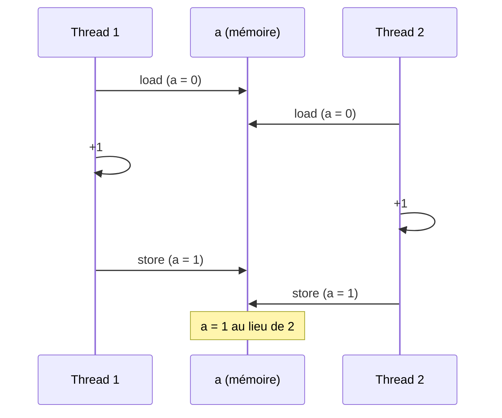

---
tags:
  - cours
  - cpp
  - parallelisme
  - threads
date: 2026-09-11
---

# Parallélisme en C++

Côté matériel et motivation, voir [[APP — MOC]] : [[Le mur de la puissance]] explique pourquoi on en est arrivé là.

## Vocabulaire

> [!note] Les mêmes concepts vus côté architecture
> [[Parallélisme, asynchronisme, concurrence|Parallélisme / Asynchronisme / Concurrence]] sont trois notions **indépendantes**.

- **Parallélisme** : un problème, on travaille à plusieurs dessus (multithreading).
- **Asynchronisme** : on lance un calcul et on obtient la réponse plus tard.
- **Concurrence** : on travaille à plusieurs en manipulant le même objet, donc on risque de se marcher sur les pieds.
- **Processus** : un programme qui s'exécute (CPU, mémoire, fichiers, stockage…). Aujourd'hui : processus = 1 programme + 1 espace de mémoire virtuelle.
- **Thread** : fil d'exécution au sein d'un processus. **Chaque thread a sa propre pile**, mais partage le tas et les variables globales avec les autres threads du processus.

---

## Créer des threads

> [!info] Headers
> `#include <thread>` pour les threads, `#include <print>` pour `println` (C++23).

```cpp
#include <thread>
#include <print>
using namespace std;

void hello() { println("hello"); }

int main() {  // thread principal
    // Création + lancement immédiat, avec une lambda
    thread t{ []() { println("hello"); } };

    // Avec une fonction
    thread t2{ hello };

    // Attendre que les threads aient bien terminé
    t.join();
    t2.join();

    // Thread alloué dynamiquement (malloc → tas)
    auto tp = new thread(hello);
    tp->join();
    delete tp;
}
```

> [!warning] `join()` obligatoire
> Un `std::thread` détruit sans avoir été `join()` (ou `detach()`) appelle `std::terminate`.

### Beaucoup de threads avec `unique_ptr`

Le `unique_ptr` libère automatiquement la mémoire à la destruction du vecteur, pas besoin de `delete`.

```cpp
#include <vector>
#include <memory>

int main() {
    vector<unique_ptr<thread>> vt(100);

    for (auto &t : vt)
        t = unique_ptr<thread>{ new thread{hello} };  // ou make_unique<thread>(hello)

    for (auto &t : vt)
        t->join();
}
```

---

## Data race

Deux threads incrémentent la même variable :

```cpp
int a = 0;

void inc() { a++; }

void boucle(function<void(void)> f) {
    for (int i = 0; i < 200000; i++)
        f();
}

int main() {
    thread t { boucle, inc };
    thread t2{ boucle, inc };
    t.join();
    t2.join();
    // a vaut rarement 400000 !
}
```

`a++` n'est pas atomique : c'est en réalité **load → +1 → store**. Si les deux threads s'entrelacent, un incrément est perdu :



> [!danger] Problème
> Plusieurs threads manipulent **simultanément la même variable**.

### Les 3 solutions

1. **Manipuler tout seul** → exclusion mutuelle (`mutex`)
2. **Ne pas partager de variable** → échange de messages (MPI, Go…). C'est le modèle des applications *[[Machines de calcul — TOP500 et BOINC|embarrassingly parallel]]*.
3. **Rendre l'opération atomique** → `atomic`

```cpp
#include <atomic>
atomic<int> a = 0;   // a++ devient atomique
```

---

## Mutex et `condition_variable`

### Version naïve (qui bloque)

```cpp
int a = 0;
bool fini = false;
mutex m;

void A() {
    m.lock();
    a = 42;
    fini = true;
    m.unlock();
}

void B() {
    m.lock();
    while (!fini);   // attente active
    println("{}", a);
    m.unlock();
}
```

> [!bug] Interblocage
> `B` garde le verrou pendant sa boucle d'attente, donc `A` ne peut jamais l'obtenir pour mettre `fini` à `true`. Et même sans verrou, l'attente active gaspille un cœur CPU.

### Version correcte avec `condition_variable`

Une `condition_variable` est une **file d'attente de threads** : un thread s'y endort, un autre le réveille.

```cpp
#include <mutex>
#include <condition_variable>

int a = 0;
bool fini = false;
mutex m;
condition_variable c;

void A() {
    unique_lock<mutex> lg{m};   // lock
    a = 42;
    fini = true;
    c.notify_one();             // réveille un thread en attente
}                               // unlock automatique

void B() {
    unique_lock<mutex> lg{m};           // lock
    c.wait(lg, []{ return fini; });     // relâche le verrou et dort tant que !fini
    println("{}", a);
}                                       // unlock automatique

int main() {
    thread t { B };
    thread t2{ A };
    t.join();
    t2.join();
}
```

> [!tip] Ce que fait `wait(lg, pred)`
> Tant que `pred()` est faux : relâche le mutex, dort, puis reprend le mutex au réveil et reteste. Le prédicat protège aussi contre les réveils intempestifs (*spurious wakeups*).

---

## Mesurer le temps

| Mesure     | Signification                              |
| ---------- | ------------------------------------------ |
| **user**   | temps de calcul en mode utilisateur        |
| **system** | temps passé dans l'OS pour le programme    |
| **real**   | *wall time*, temps réel écoulé             |

En ligne de commande :

```bash
/usr/bin/time ./programme > /dev/null
/usr/bin/time -f "%U user %S sys %e real" ./programme
```

Dans le code :

- ❌ `gettimeofday()` : à ne pas utiliser (obsolète)
- ✅ `clock_gettime()` : secondes + nanosecondes

```cpp
#include <time.h>

timespec debut, fin;
clock_gettime(CLOCK_MONOTONIC, &debut);
// ... calcul ...
clock_gettime(CLOCK_MONOTONIC, &fin);

double duree = (fin.tv_sec - debut.tv_sec)
             + (fin.tv_nsec - debut.tv_nsec) / 1e9;
```

---
### Compilateur 
Niveau d'optimisation :
- O0 (default) ne fait rien : c'est le mode debug . -O2 est le niveau raisonnable . -O3 ajoute la vectorisation 
## Voir aussi

- [[APP — MOC]] — la carte du cours : [[Le mur de la puissance|mur de la puissance]], [[Machines de calcul — TOP500 et BOINC|TOP500 et BOINC]], [[Localité et caches|localité et caches]]
- [[Ordonnancement et théorème de Graham]] — le modèle qui explique ce que coûte la synchronisation
- [[OPENMP]] — parallélisme par directives, au-dessus des threads
