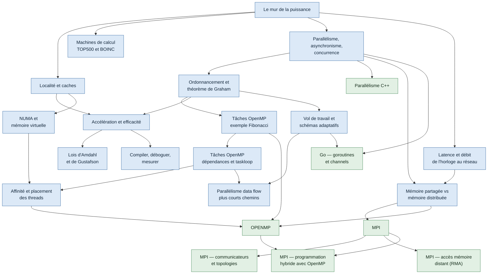

# APP — Algorithmes et Programmation Parallèle

> [!abstract] Le fil du cours
> Les processeurs n'accélèrent plus → il faut plusieurs cœurs → il faut découper le travail → un ordonnanceur le distribue → on mesure ce qu'on y a gagné.

Contrairement au séquentiel, la programmation parallèle n'a pas de paradigme unique stabilisé. L'UE en couvre les principales familles : **OpenMP** (mémoire partagée), **MPI** (mémoire distribuée) et **Go** (channels), plus C++ et Guile (Scheme) pour les opérateurs parallèles de haut niveau. L'algorithmique parallèle est abordée **par la programmation** ; les GPU ne sont pas au programme (→ 5MMGPUHP en 3A), l'algorithmique parallèle poussée est en 4MMAA (S2).

Ce dossier sépare le **pourquoi** (matériel, modèles, métriques) dans `Concepts/`, et le **comment** dans les notes outils : [[Parallélisme C++]], [[OPENMP]], [[MPI]], [[Go — goroutines et channels]]. Les supports sont dans `CM/` (slides) et `TP/` (énoncés + sources).

## Calendrier des séances

| Séance | Date | Thème | Notes | Support |
| --- | --- | --- | --- | --- |
| CM1 | 08/09 | Concurrence en mémoire partagée en C++ : moniteur, sémaphores, barrières | [[Parallélisme C++]] | — |
| CM2 | 11/09 | OpenMP et concepts : matériel, Amdahl/Gustafson, compilation, debug-profile-optimize | [[OPENMP]], [[Lois d'Amdahl et de Gustafson]], [[Compiler, déboguer, mesurer]], [[Localité et caches]] | `CM/cours2-slides.pdf` |
| TP | 15/09 | Programmation concurrente C++ | [[Parallélisme C++]] | `TP/tp1-Cpp.pdf` |
| TP | 18/09 | Introduction à OpenMP | [[OPENMP]] | `TP/tp1-OMP.pdf`, `TP/srcTP1/` |
| CM3 | 22/09 | Tâches et ordonnancement ; OpenMP la suite | [[Ordonnancement et théorème de Graham]], [[Tâches OpenMP — exemple Fibonacci]] | — |
| CM4 | 25/09 | Dépendances de tâches, localité, NUMA, affinité | [[Tâches OpenMP — dépendances et taskloop]], [[NUMA et mémoire virtuelle]], [[Affinité et placement des threads]] | `CM/openmp-numa-affinity-memoirevirtuelle.pdf` |
| TP | 02/10 | Tâches en OpenMP (tri fusion) | [[Tâches OpenMP — dépendances et taskloop#TP2 — tri par fusion\|TP2]] | `TP/tp2-OMP-taches.pdf`, `TP/srcTP2/` |
| ~~CM5~~ | ~~06/10~~ | *reporté (fermeture de l'Ensimag)* | | |
| TP | 09/10 | Tâches, dépendances et affinité (Cholesky) | [[Tâches OpenMP — dépendances et taskloop#TP3 — Cholesky par blocs\|TP3 ex. 1]], [[Affinité et placement des threads#En TP — TP3, exercice 2\|TP3 ex. 2]] | `TP/tp3-OMP-taches.pdf`, `TP/srcTP3/` |
| CM5 | 13/10 | Mémoire distribuée, MPI : point à point | [[Mémoire partagée vs mémoire distribuée]], [[MPI]] | — |
| CM6 | 16/10 | MPI : non bloquant, collectives, communicateurs, RMA | [[MPI]], [[MPI — communicateurs et topologies]], [[MPI — accès mémoire distant (RMA)]] | `CM/CM2-MPI-CommCollectives.pdf` |
| TP | 20/10 | Introduction à MPI | [[MPI#TP1 — passage de messages\|TP1 MPI]] | `TP/tp1-MPI.pdf` |
| TP | 23/10 | MPI : communications collectives et non bloquantes | [[MPI#TP2 — diffusion et recouvrement\|TP2 MPI]] | `TP/tp2-MPI.pdf`, `TP/srcTP-MPI-2/` |
| CM | 03/11 | Go | [[Go — goroutines et channels]] | — |
| TP | 06/11 | Programmation hybride MPI + OpenMP | [[MPI — programmation hybride avec OpenMP]] | `TP/tp3-MPI-OMP.pdf`, `TP/srcTP-MPI-OMP-3/` |
| TP | 10/11 | Go | [[Go — goroutines et channels]] | `TP/tp7-go.pdf` *(plus lié sur le site, à confirmer)* |
| CM | 13/11 | Tâches et ordonnancement II : vol de travail (théorie et pratique), *folding*, schémas adaptatifs ; parallélisme *data flow* (plus court chemin dans un graphe) | [[Vol de travail et schémas adaptatifs]], [[Parallélisme data flow — plus courts chemins]] | — *(pas de support en ligne)* |
| CM | 17/11 | Go, suite | [[Go — goroutines et channels]] | |
| TP | 20/11 | Vol de travail avec Go | [[Vol de travail et schémas adaptatifs#Qui utilise le vol de travail\|ordonnanceur de Go]], [[Go — goroutines et channels]] | |
| CM | 24/11 | Programmation fonctionnelle parallèle (Guile) : préfixe parallèle, K-means et sa parallélisation, *lazy streams* | | |
| CM | 27/11 | `promise`/`future`/`async` et programmation parallèle dans la bibliothèque C++ | | |
| TP | 01/12 | Guile | | |
| TP | 04/12 | C++ | | |

## Carte du cours

## Concepts

| Note | Ce qu'on y trouve |
| --- | --- |
| [[Le mur de la puissance]] | Fréquences bloquées à 3–5 GHz, 0,75 c et les 6,4 cm par cycle |
| [[Machines de calcul — TOP500 et BOINC]] | HPL/HPCG, El Capitan, Fugaku, BOINC et l'*embarrassingly parallel* |
| [[Parallélisme, asynchronisme, concurrence]] | Les trois notions indépendantes, et leur traduction en C++ |
| [[Localité et caches]] | Localité spatiale/temporelle, ligne de cache, MESI, faux partage mesuré, SIMD |
| [[NUMA et mémoire virtuelle]] | UMA → NUMA, pages, MMU/TLB, allocation paresseuse, *first touch*, `numactl` |
| [[Affinité et placement des threads]] | `OMP_PLACES`, `OMP_PROC_BIND`, `close`/`spread`, triade, Jacobi 2D, check-list NUMA |
| [[Ordonnancement et théorème de Graham]] | DAG de tâches, travail/profondeur, glouton, borne $2 - 1/m$ et sa preuve |
| [[Tâches OpenMP — exemple Fibonacci]] | `task`/`depend`/`taskwait`, granularité, seuil de récursion |
| [[Vol de travail et schémas adaptatifs]] | Partage vs vol, $\mathbb{E}[T_p] \le W/p + O(CP)$, potentiel de deque (preuve ABP, lemmes vérifiés), $O(p \cdot CP)$ vols, *work-first*, ordonnanceur de Go, préfixe adaptatif |
| [[Parallélisme data flow — plus courts chemins]] | Règle de tir, Dijkstra vs relaxation, *data flow* naïf en Go (×30 de travail), Δ-stepping mesuré |
| [[Tâches OpenMP — dépendances et taskloop]] | Types de `depend`, `inoutset`, `taskgroup`, `taskloop` et son piège, tri fusion, Cholesky |
| [[Accélération et efficacité]] | $S_m$, $E_m$, speedup absolu/relatif, super-linéarité |
| [[Lois d'Amdahl et de Gustafson]] | Plafond $1/\alpha$, scalabilité forte/faible, métrique de Karp-Flatt |
| [[Compiler, déboguer, mesurer]] | Règle d'or, `-O2`, `-ffast-math`, ThreadSanitizer, `perf`, intensité arithmétique |
| [[Latence et débit — de l'horloge au réseau]] | Cycles comme unité : du cache L1 (4) à Sydney (6·10⁸), OS, débit, borne de la lumière, horloges |
| [[Mémoire partagée vs mémoire distribuée]] | Les deux architectures, SPMD, coût $\alpha + n/\beta$ d'un message, halos |

## Mise en pratique

| Note | Contenu |
| --- | --- |
| [[Parallélisme C++]] | `std::thread`, data race, `mutex`, `condition_variable`, mesure du temps |
| [[OPENMP]] | Fork/join, partage des données et ses pièges, `for`/`schedule`, réduction, synchronisation, π en 4 versions |
| [[MPI]] | Point à point, interblocage, non bloquant, fantômes, maître/travailleurs, collectives, préparation des machines, TP 1 et 2 |
| [[MPI — communicateurs et topologies]] | `Comm_split`, grilles cartésiennes, produit matrice-vecteur $q \times q$ |
| [[MPI — accès mémoire distant (RMA)]] | Fenêtres, `Put`/`Get`/`Accumulate`, `fence`, PSCW, verrous, compteur sans maître |
| [[MPI — programmation hybride avec OpenMP]] | Placement `PE=` et `-x`, `MPI_Init_thread`, Mandelbrot (`blocs`/`cyclique`), Jacobi hybride |
| [[Go — goroutines et channels]] | `go`, channels, fermeture à plusieurs écrivains, `select`, pipeline, pièges du TP *(cours à compléter)* |

## Supports

| Dossier | Fichier | Contenu |
| --- | --- | --- |
| `CM/` | `cours2-slides.pdf` | CM2 — concepts du parallélisme, OpenMP (201 p.) |
| `CM/` | `openmp-numa-affinity-memoirevirtuelle.pdf` | CM4 — tâches (suite), NUMA, affinité (56 p.) |
| `CM/` | `CM2-MPI-CommCollectives.pdf` | CM6 — MPI non bloquant, collectives, communicateurs, RMA (41 p.) |
| `TP/` | `tp1-Cpp.pdf` | TP concurrence C++ (mon travail : `hello*.cc`, `comptage.cc`, `lg.cc`) |
| `TP/` | `tp1-OMP.pdf` + `srcTP1/` | TP intro OpenMP (mon travail : `TP-OPENMP/`) |
| `TP/` | `tp2-OMP-taches.pdf` + `srcTP2/` | TP tâches : π en `taskloop`, tri fusion V1–V3 |
| `TP/` | `tp3-OMP-taches.pdf` + `srcTP3/` | TP Cholesky par tâches, affinité |
| `TP/` | `tp1-MPI.pdf` | TP introduction à MPI |
| `TP/` | `tp2-MPI.pdf` + `srcTP-MPI-2/` | TP MPI collectives et non bloquant : `diffusion.c`, `recouvrement.c` |
| `TP/` | `tp3-MPI-OMP.pdf` + `srcTP-MPI-OMP-3/` | TP hybride MPI + OpenMP : `jacobi.c`, `mandel.c` |
| `TP/` | `tp7-go.pdf` | TP goroutines et channels (plus lié sur le site au 09/11) |

## Repères chiffrés

| Grandeur | Valeur |
| --- | --- |
| Fréquence des CPU | 3–5 GHz, stagnante depuis 20 ans |
| Distance parcourue en 1 cycle | ≈ 6,4 cm |
| L1 → RAM → ping Sydney | 4 → 362 → 563 millions de cycles |
| Coût du noyau (MPI TCP vs mémoire partagée) | ×40 |
| El Capitan (HPL) | 1,742 Exaflop/s, ~11 M cœurs, 29 MW |
| Fugaku, sans accélérateur | 442 Pflop/s, 7,6 M cœurs ARM ; 53 % du TOP500 sans accélérateur |
| BOINC (2024) | 3,04 Pflop/s → rang ~275 du TOP500 |
| Garantie d'un ordonnancement glouton | $\le (2 - 1/m) \cdot T_{opt}$ |
| Amdahl, 5 % séquentiel | $S_\infty = 20$ ; $S_{1024} = 19{,}6$ — Gustafson : 973 |
| Faux partage (2 compteurs dans une ligne) | ×5 plus lent ; transition mesurée à 32 o (annoncé 64) |
| π avec `atomic` à chaque itération | 132× plus lent que le séquentiel ; `reduction` : $S_8 = 5{,}3$ |
| Page mémoire (x86-64) | 4 Kio — unité de placement NUMA |
| Diffusion à $p = 1024$ | 1023 envois successifs contre 10 étapes en arbre binomial |
| Seuil *eager* Open MPI (mémoire partagée) | 4 096 o — au-delà, un `Send`/`Send` symétrique bloque |
